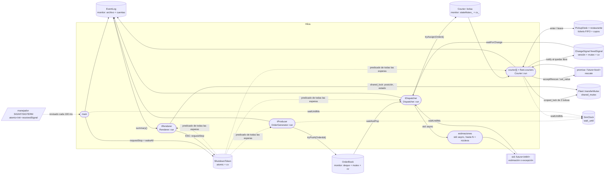

# Equipetrol Delivery

Simulación concurrente de despacho de pedidos de comida sobre la Zona Equipetrol (Santa Cruz de la Sierra, Bolivia), escrita en C++17. Trabajo final del curso de Concurrencia en C++.

Varios hilos trabajan al mismo tiempo:
- un generador de pedidos;
- un despachador que pide estimaciones en paralelo;
- un hilo por cada motociclista repartidor;
- una ventana que dibuja el mapa en vivo.

Los repartidores comparten restaurantes con cupos limitados, llevan una bolsa de capacidad limitada, se averían y se transfieren pedidos entre sí, **sin perder, duplicar ni corromper ningún pedido**.

## Índice
1. [Compilación](#compilación)
2. [Ejecución](#ejecución)
3. [Esquema del programa: hilos y canales](#esquema-del-programa-hilos-y-canales)
4. [Mapa de conceptos](#mapa-de-conceptos)
5. [Experimentos](#experimentos)
6. [Análisis con herramientas](#análisis-con-herramientas)
7. [Dependencias](#dependencias-versiones-usadas)
8. [Mapa y atribución](#mapa-y-atribución)
9. [Documentación adicional](#documentación-adicional)
10. [Uso de inteligencia artificial](#uso-de-inteligencia-artificial)

---

## Compilación

```bash
mkdir build && cd build
cmake .. && make
```

La primera configuración descarga nlohmann/json y Catch2 (unos 1,2 MB), por eso necesita internet. La compilación no produce warnings con `-Wall -Wextra -Wpedantic`.

**Windows (MSYS2 UCRT64):** CMake usa Ninja por defecto. Para que `cmake ..` genere archivos para `make`, la variable de entorno de usuario `CMAKE_GENERATOR` vale `MinGW Makefiles` (DD-022):

```powershell
[Environment]::SetEnvironmentVariable("CMAKE_GENERATOR", "MinGW Makefiles", "User")
```

**Sanitizers** (en Linux o WSL2, porque MSYS2 no los incluye; DD-006):

```bash
cmake -DENABLE_TSAN=ON .. && make   # ThreadSanitizer (mismo target delivery_sim)
cmake -DENABLE_ASAN=ON .. && make   # AddressSanitizer + LeakSanitizer
```

**Tests:** `cd build && ctest --output-on-failure` (70 tests).

## Ejecución

```bash
./delivery_sim ../config/equipetrol.json
./delivery_sim ../config/equipetrol.json --log run1.log
```

- Cuando todos los hilos están en marcha imprime `Simulation has started...`.
- Abre una ventana con el mapa, los restaurantes, cada repartidor como un punto que se mueve por las calles (con un color por estado), los puntos de entrega y un panel de contadores.
- Cada cambio de estado se escribe como una línea JSON en `events.log` (o en la ruta de `--log`).
- Al terminar imprime el resumen JSON de la sección 6.3.
- **Detención:** por duración (`simulation.durationS`; con `0` corre hasta una señal), **Ctrl+C (SIGINT)**, **SIGTERM**, **ESC** o cerrando la ventana. En todos los casos deja de crear pedidos, registra `simulationStopping`, une todos los hilos, imprime el resumen y sale con código 0 en unos 0,1 s.
- Con una configuración inválida muestra un mensaje en stderr y sale con código distinto de cero, sin simular.

Verificar un registro y su resumen con las reglas del brief:
```bash
./delivery_sim ../config/equipetrol.json --log run1.log > salida.txt
python ../tools/check_event_log.py run1.log salida.txt
```

---

## Esquema del programa: hilos y canales



| Hilo | Qué ejecuta | Sobre qué itera | Dónde espera (sin consumir CPU) | Lo crea / lo une |
|---|---|---|---|---|
| `main` | `main()` | — | `ShutdownToken::waitForStopUntil` en tramos de 100 ms (duración, señal o ESC) | — |
| `tProducer` | `OrderGenerator::run` | Un pedido o una ráfaga por intervalo aleatorio (Poisson) | `SimClock::waitUntilMs(próximo pedido)` | `main` / `main` |
| `tDispatcher` | `Dispatcher::run` | Cada pedido del libro: alcanzable → estimaciones → asignación | `OrderBook::waitAndPop`, `future::wait_until(quoteTimeoutMs)`, `freedSignal.waitForChange(acceptTimeoutMs)` | `main` / `main` |
| estimaciones | `Dispatcher::estimateDeliveryMs` vía `std::async(std::launch::async, …)` | Una estimación (Dijkstra) por candidato | No esperan: calculan y terminan | `std::async` / destructor del `future` |
| `courier[i]` | `Courier::run` | Cada viaje: restaurante → fila del mostrador → comida lista → entregas; dentro, cada tramo y cada paso | `cv_.wait` (sin pedidos), `PickupDesk::enter`, `SimClock::waitUntilMs`, `future<bool>::get` (esperando rescate) | `Fleet::start` / `Fleet::join` |
| `tRenderer` | `Renderer::run` | Un cuadro cada ~33 ms | `cv::waitKey(33)` (pausa para fijar los FPS, permitida por el brief) | `main` / `main` |

**Orden de apagado:** `requestStop()` → `simulationStopping` → `clock.wakeAll()` → `book.wakeAll()` → `freedSignal.wakeAll()` → `join` del generador, del despachador y de la ventana → `fleet.join()`, que despierta repartidores y mostradores y los une. Cada `wake`/`wakeAll` toma su mutex antes de notificar, para evitar el despertar perdido (DD-017).

El argumento de por qué **no hay condición de carrera en cada objeto compartido** está en [`docs/architecture.md`, sección 6](docs/architecture.md#6-argumento-contra-condiciones-de-carrera-por-objeto-compartido-fila-10).

---

## Mapa de conceptos

| # | Carpeta | Concepto | Archivo y lugar | Justificación (por qué aquí y qué fallaría sin él) |
|---|---|---|---|---|
| 1 | 01 | Creación explícita de hilos y un destino deliberado (unido, nunca abandonado) | `src/main.cpp`: `std::thread tProducer`, `tDispatcher`, `tRenderer` y sus `join()`. `src/sim/Fleet.cpp`: `Fleet::start` crea un hilo por repartidor y `Fleet::join` los une; el destructor de `Fleet` llama a `join`. | Cada hilo se une antes de que termine `main`, así el resumen se imprime cuando ya nadie escribe datos. Un `std::thread` destruido sin `join` llama a `std::terminate` y aborta el programa. |
| 2 | 01 | Decisión que depende del paralelismo del hardware | `src/sim/Dispatcher.cpp`, `chooseMaxCandidates()`: por pedido se piden estimaciones como máximo a `max(2, std::thread::hardware_concurrency())` repartidores, los más cercanos al restaurante. | Cada estimación es un hilo. Con 64 repartidores, lanzar 64 hilos por pedido en una máquina de 8 núcleos sería *sobresuscripción*: los hilos competirían por los núcleos y todo iría más lento. |
| 3 | 02 | Datos por valor, por referencia y por movimiento | **Referencia:** `OrderGenerator(const Config&, OrderBook&, ShutdownToken&, SimClock&, …, EventLog&)`. **Valor:** cada hilo de estimación recibe su copia de `QuoteRequest` (`[this, courier, request]` en `Dispatcher::chooseCourier`). **Movimiento:** `OrderBook::tryPush(Order&&)`. | Libro, reloj y registro deben ser **el mismo** objeto para todos (además, un `mutex` no se puede copiar). La copia de `QuoteRequest` protege al hilo de estimación, que puede seguir vivo cuando el despachador ya pasó a otro pedido. Los pedidos se mueven para existir en un solo lugar. |
| 4 | 02 | Pedidos que viajan por movimiento, en un solo lugar a la vez | `src/sim/OrderGenerator.cpp`: `book_.tryPush(std::move(*maybeOrder))`. `src/concurrency/OrderBook.cpp`: `queue_.push_back(std::move(order))`, `std::move(queue_.front())`. `src/sim/Courier.cpp`: `bag_.push_back(std::move(order))` en `tryAssign` (solo si acepta) y en la transferencia de `performRescue`. | El pedido pasa del generador al libro, al despachador y a una bolsa sin copias. Si se copiara, podrían existir dos versiones y dos hilos procesarlo, rompiendo "un pedido nunca se entrega dos veces". |
| 5 | 03 | Funciones miembro de objetos compartidos ejecutándose en hilos; contenedores de hilos | `src/sim/Fleet.cpp`: `threads_.emplace_back([ptr] { ptr->run(); })` y `std::vector<std::thread> threads_`. `src/main.cpp`: `generator.run()`, `dispatcher.run()`, `renderer.run()`. | Cada actor es un objeto con su estado cuya función `run` es el trabajo del hilo. El vector permite crear y unir N repartidores con un bucle, sin olvidar ninguno. |
| 6 | 03 | Propiedad compartida que garantiza el tiempo de vida; ningún puntero crudo con propiedad | `StreetNetwork::build` devuelve `std::shared_ptr<const StreetNetwork>`, compartido por despachador y repartidores. `Fleet` guarda `std::vector<std::unique_ptr<Courier>>`. | El grafo vive mientras alguien lo use, y `const` permite leerlo sin candado. Cada repartidor tiene un único dueño (la flota). Los punteros crudos (`Courier*` en `Fleet::start` o en el pedido de rescate) **no** son dueños: el objeto vive en `couriers_` hasta después del `join`. |
| 7 | 04 | Tareas que devuelven un resultado por un `future`, con política de lanzamiento declarada | `src/sim/Dispatcher.cpp`, `chooseCourier`: `std::async(std::launch::async, …)` devuelve un `std::future<std::int64_t>` por candidato. | `launch::async` obliga a usar un hilo nuevo: las estimaciones corren **a la vez**. Con `deferred` se ejecutarían una tras otra al llamar a `get()`. |
| 8 | 04 | Par promise/future como canal de un solo uso | `src/sim/Courier.cpp`: `acceptRescue` guarda un `std::promise<bool>` en el rescatista y devuelve el `std::future<bool>` al averiado; el rescatista responde `set_value(true)` tras transferir, o `false` si se apaga antes; el averiado espera con `get()`. | Es una respuesta única de un hilo concreto a otro. Con una `condition_variable` harían falta mutex, bandera y predicado compartidos; el `future` lo encapsula y no puede contestarse dos veces. |
| 9 | 04 | Espera con límite de tiempo y excepción que cruza de un hilo a otro | `Dispatcher::chooseCourier`: `quotes[i].wait_until(deadline)` con un límite común `ahora + quoteTimeoutMs`; las tardías se ignoran. `estimateDeliveryMs` lanza `std::runtime_error` si el repartidor no puede llegar; reaparece en `quotes[i].get()` dentro de un `try/catch`. Test: `tests/test_dispatcher.cpp`. | El límite común asegura que la espera total no supera `quoteTimeoutMs`. Sin `future`, una excepción en otro hilo terminaría el programa; con él, llega al despachador como un valor más. |
| 10 | 05 | Argumento escrito, por objeto compartido, de por qué no hay condición de carrera | [`docs/architecture.md`, sección 6](docs/architecture.md#6-argumento-contra-condiciones-de-carrera-por-objeto-compartido-fila-10): `OrderBook`, `ShutdownToken`, `SimClock`, `Courier`, transferencias, `EventLog`, `ChangeSignal`, `PickupDesk`, `Dispatcher`, `StreetNetwork`, `Config`, `Renderer` y atómicos. | Cada objeto tiene una regla explícita: candado, atómico o inmutabilidad. ThreadSanitizer lo confirma: 0 avisos ([análisis](docs/tools-analysis.md)). |
| 11 | 05 | Tipo seguro de copiar o mover porque sus funciones miembro especiales son correctas | `include/delivery/core/Order.hpp`: `struct Order` solo con miembros de valor. `tests/test_order_book.cpp` (T7): `static_assert` de copia, movimiento y movimiento `noexcept`. | Todos sus miembros (`std::string` envueltos, enteros, `enum class`) se copian y mueven bien, así que las funciones generadas por el compilador son correctas. |
| 12 | 06 | Exclusión mutua solo con bloqueos de ámbito; secciones críticas cortas | `std::lock_guard`, `std::unique_lock`, `std::scoped_lock`, `std::shared_lock` en todo el código; ningún `lock()`/`unlock()` manual. `Courier::run` copia `currentNode_` bajo el candado y calcula Dijkstra **fuera**; `EventLog` arma el JSON **antes** de tomar el candado. | Si hay una excepción o un `return`, el candado se libera solo. Las secciones cortas evitan que la ventana o el despachador esperen detrás de un cálculo lento. |
| 13 | 06 | Operación que necesita dos bloqueos a la vez y por qué no hay interbloqueo | `src/sim/Courier.cpp`, `performRescue`: `std::unique_lock` sobre `transferMutex` y luego `std::scoped_lock bothBags(stateMutex_, broken.stateMutex_)` para mover **todos** los pedidos de una bolsa a la otra. | Todo-o-nada exige ambas bolsas bloqueadas a la vez. `scoped_lock` adquiere los dos sin interbloqueo aunque dos hilos los pidan en distinto orden, y `transferMutex` se toma siempre primero. Los lectores lo toman en modo compartido y nunca ven un pedido en dos bolsas ni en ninguna. |
| 14 | 07 | Objetos monitor: datos compartidos inalcanzables sin su bloqueo | `OrderBook` (cola privada), `Courier` (bolsa, posición y estado bajo `stateMutex_`; las consultas devuelven copias), `PickupDesk`, `ChangeSignal`, `EventLog` (cada línea se escribe entera con el candado). | Nadie fuera del objeto puede tocar sus datos sin el candado, porque no hay forma de llegar a ellos. En `EventLog`, eso garantiza que dos eventos nunca se mezclan en una línea. |
| 15 | 07 | Hilos que se bloquean hasta una condición, resistentes a despertares sin novedad y con un despertar final para el apagado | `OrderBook::waitAndPop`: `cv_.wait(lock, [&]{ return !queue_.empty() \|\| stop.stopRequested(); })`. `Courier::run`: `cv_.wait(lock, [&]{ return !bag_.empty() \|\| rescueRequest_.has_value() \|\| stop; })`. `PickupDesk::enter`: espera turno (ticket FIFO) **y** cupo. `ChangeSignal::waitForChange` y `SimClock::waitUntilMs` con `wait_until`. Despertar final: `wakeAll()`/`wake()` en el apagado. | El predicado se revisa en cada despertar: si no hay novedad, el hilo vuelve a dormir. El despertar final toma el mutex antes de notificar, así la señal de apagado no se pierde aunque llegue justo cuando el hilo se iba a dormir (DD-017). |

---

## Experimentos

Informe completo: [`docs/experiments.md`](docs/experiments.md). Datos crudos (configuración, registro de eventos y resumen de cada ejecución): [`experiments/`](experiments/). Cada experimento varía **un solo** parámetro y repite cada variante con las semillas 42, 43 y 44 (promedios, una hora simulada).

| Experimento | Variable | Resultado principal |
|---|---|---|
| 1. Capacidad de la bolsa | `fleet.bagCapacity` = 1, 2, 3 | Rechazados 16,7 → **0**; entrega promedio 16,4 → **13,8 min**. **Cambio de diseño:** bolsa por restaurante (Etapa 6). |
| 2. Cantidad de repartidores | `fleet.couriers` = 5, 8, 15, 25 | Con menos de 15 la flota es el cuello de botella (con 5 se rechaza más de la mitad); por encima, más rapidez con rendimientos decrecientes. |
| 3. Probabilidad de avería | `incidents.breakdownProbability` = 0; 0,1; 0,3; 1 | Al 10 % casi no afecta; al 100 % las entregas caen un tercio, pero el sistema nunca se bloquea (DD-027). |

Antes y después del cambio de diseño:

| | Un pedido por viaje | Bolsa de 3 |
|---|---|---|
| Rechazados | 16,7 | 0,0 |
| Entregados | 53,0 | 65,0 |
| Entrega promedio | 16,4 min | 13,8 min |

---

## Análisis con herramientas

Informe completo: [`docs/tools-analysis.md`](docs/tools-analysis.md). Salidas completas y sin editar: [`analysis/raw/`](analysis/raw/).

Cada herramienta observó una ejecución completa de `config/equipetrol.json` con la ventana abierta, ráfagas de hasta 12 pedidos simultáneos, averías y apagado por **SIGINT** (`tools/run_with_signal.sh`), en Ubuntu 26.04 (WSL2) con g++ 15.2.

| Herramienta | Comando | Primera ejecución | Cambio | Resultado final |
|---|---|---|---|---|
| ThreadSanitizer (GCC 15.2) | `cmake -DENABLE_TSAN=ON .. && make`, luego `run_with_signal.sh` | 5 avisos, **todos dentro de `libQt5Core`/`libdbus`** (falsos positivos de bibliotecas no instrumentadas) | Supresiones solo para esas bibliotecas, incluidas en el programa (`src/analysis/tsan_default_suppressions.cpp`). Un programa de prueba con una carrera propia sigue siendo detectado. | **0 avisos**, código 0 |
| AddressSanitizer + LeakSanitizer (GCC 15.2) | `cmake -DENABLE_ASAN=ON .. && make`, luego `run_with_signal.sh` | 0 errores, 0 fugas | Ninguno necesario | **0 errores, 0 fugas** |

Los 70 tests también se ejecutan sin reportes bajo ambas herramientas. Durante el desarrollo, TSan se usó en cada PR. Detectó dos errores **en los tests**, ya corregidos: `REQUIRE` de Catch2 dentro de hilos y una lectura de dos datos en dos llamadas separadas.

---

## Dependencias (versiones usadas)

| Componente | Versión | Uso |
|---|---|---|
| C++ | 17 | Estándar del proyecto |
| g++ (MSYS2 UCRT64, Windows) | 16.2.0 | Compilador |
| g++ (Ubuntu 26.04, WSL2) | 15.2.0 | Compilador para ThreadSanitizer y AddressSanitizer |
| CMake | 4.4.3 (Windows), 4.2.3 (WSL) | Sistema de compilación (mínimo 3.16) |
| GNU Make | 4.4.1 | Construcción |
| OpenCV | 5.0.0 (Windows), 4.10.0 (WSL) | Solo la ventana |
| nlohmann/json | 3.11.3 | Leer la configuración y escribir el registro de eventos |
| Catch2 | 3.5.2 | Tests (solo en `delivery_tests`) |
| Python | 3.13 | Scripts de `tools/` (generar el mapa, verificar registros, experimentos) |

La concurrencia usa solo la biblioteca estándar de C++17: `std::thread`, `std::mutex`, `std::shared_mutex`, `std::condition_variable`, `std::atomic`, `std::future`/`std::promise` y `std::async`.

## Mapa y atribución

El mapa, las calles y los restaurantes provienen de OpenStreetMap y se generan con `tools/osm_to_config.py`. El área va del Segundo al Cuarto Anillo, con la Av. San Martín. El grafo es fuertemente conexo: 83 intersecciones, 138 nodos y 181 calles (DD-025).

**© OpenStreetMap contributors.** Los datos de OpenStreetMap se publican bajo la licencia ODbL: https://www.openstreetmap.org/copyright. La atribución también se muestra en la ventana de la simulación.

## Documentación adicional

| Documento | Contenido |
|---|---|
| [`docs/modules-guide.md`](docs/modules-guide.md) | Qué hace cada módulo, explicado para cualquier lector. |
| [`docs/architecture.md`](docs/architecture.md) | Capas, hilos, canales y argumento contra condiciones de carrera. |
| [`docs/design-decisions.md`](docs/design-decisions.md) | Registro de decisiones de diseño (DD-001 a DD-030). |
| [`docs/progress.md`](docs/progress.md) | Etapas, criterios de la rúbrica, problemas conocidos y demoras. |
| [`docs/experiments.md`](docs/experiments.md) | Experimentos (DP.10). |
| [`docs/tools-analysis.md`](docs/tools-analysis.md) | Análisis con herramientas (DP.11). |

## Uso de inteligencia artificial

Durante el desarrollo usé **Claude Code** (Anthropic) como asistente de programación:

- Revisar el código y detectar errores. Por ejemplo, el *despertar perdido* al apagar y el "teletransporte" de los repartidores.
- Proponer y aplicar correcciones, cada una con sus tests, en Pull Requests pequeños que revisé antes de integrarlos.
- Configurar la compilación, ejecutar ThreadSanitizer y AddressSanitizer y redactar documentación.

Revisé y aprobé cada cambio antes de integrarlo. Cada Pull Request tiene notas de estudio con la explicación de los conceptos aplicados, para poder explicar cada línea del código.
