# Equipetrol Delivery en GPU: aplicaciones por concepto e informe de rendimiento

Este informe resume las diez aplicaciones GPU añadidas al simulador de reparto (una por cada concepto, de `03_memory_tiling` a `12_sorting`). Para cada una responde con mediciones a tres preguntas: **¿conviene la GPU para esta tarea?, ¿a partir de qué tamaño? y ¿por qué?**

Todas las tablas y figuras se generan con `tools/gpu_report.py` a partir de dos archivos CSV, uno del portátil y otro de Colab. Esos CSV los escribe el propio simulador en modo `--bench`, y sus copias están en `datos/`.

**Índice de figuras:**

| Figura | Qué muestra | Apartado |
|---|---|---|
| `thread_sweep.png` | Speedup de la CPU con 1, 2, 4 y 8 hilos en el portátil | 2.3 |
| `<aplicación>_time.png` (10) | Tiempo frente a tamaño de las 4 versiones, log–log, con el cruce marcado | 3.1–3.10 |
| `<aplicación>_copy_share.png` (10) | Parte del tiempo de GPU en copias frente a kernels, por tamaño | 3.1–3.10 |
| `ventana_equipetrol_heatmap.png` | La ventana de la simulación con la capa del mapa de calor | 3.3 |
| `histograma_entregas_ciudad.png` | El histograma de tiempos de entrega y los percentiles calculados en la T4 (`tools/histogram_plot.py`) | 3.5 |
| `ventana_ciudad.png` | La ventana de la ciudad con el dibujo simplificado | 5.2 |
| `roofline.png` | Roofline de la T4 con los kernels principales | 4.1 |
| `fps_frames.png` | FPS por ejecución y distribución del intervalo entre cuadros (`tools/fps_report.py`) | 5.2 |

**Guía de lectura: el resultado de cada aplicación frente a su rendimiento.** Cada aplicación tiene dos tipos de evidencia que no deben confundirse:
- El **resultado** es lo que calcula la aplicación dentro de la simulación: un histograma, un mapa de calor, una asignación. Demuestra que la GPU hace algo útil y correcto.
- El **rendimiento** es lo que cuesta calcularlo. Las figuras `_time.png` comparan el tiempo de la CPU y de la GPU según el tamaño, y las `_copy_share.png` muestran qué parte del tiempo de la GPU se va en copias. Por ejemplo, `delivery_histogram_time.png` **no** es un histograma: es el coste de calcularlo.

Las líneas de texto citadas están en `datos/sim/resultados_gpu_ciudad.txt` y `datos/sim_gpu.err`, que es lo que imprime el simulador al terminar 1 hora simulada de la ciudad en la T4.

| # | Aplicación | Dónde se ve el resultado | Figuras de rendimiento | Apartado |
|---|---|---|---|---|
| 1 | Tabla de tiempos de viaje | Texto: `Travel table: 4096 nodes on GPU` (línea 2). El despachador la usa para estimar los tiempos de viaje | `travel_table_*` | 3.1 |
| 2 | ETA por lotes | Las asignaciones pedido → repartidor del despachador (`assigned` en `datos/fps/sim_effect_city_modes.md`) | `eta_batch_*` | 3.2 |
| 3 | Mapa de calor | **Imagen:** `ventana_equipetrol_heatmap.png`. Texto: `Demand heatmap … hottest cell` (línea 6) | `demand_heatmap_*` | 3.3 |
| 4 | Campo de cobertura | Texto: `Coverage field … least covered cell` (línea 7), la zona donde conviene esperar | `coverage_field_*` | 3.4 |
| 5 | Histograma | **Imagen:** `histograma_entregas_ciudad.png`. Texto: `Delivery-time histogram` (línea 3) | `delivery_histogram_*` | 3.5 |
| 6 | Argmin | El repartidor elegido para cada pedido (mismas asignaciones que la ETA) | `dispatch_argmin_*` | 3.6 |
| 7 | Agrupación (scan) | Texto: `Deliveries grouped by restaurant` (`datos/sim_gpu.err`, línea 5) | `orders_by_restaurant_*` | 3.7 |
| 8 | Filtro | Los candidatos que pasan a la ETA; se refleja en las asignaciones | `candidate_filter_*` | 3.8 |
| 9 | Mezcla (merge) | Texto: `Merged delivery timeline … busiest 10-minute window` (línea 5) | `courier_log_merge_*` | 3.9 |
| 10 | Ordenación | Texto: `Delivery-time percentiles` (línea 4). **Imagen:** las líneas p50, p90 y p99 de `histograma_entregas_ciudad.png` | `delivery_percentiles_*` | 3.10 |

---

## 1. Resumen

**Columnas de la tabla:**
- **Cruce:** el tamaño a partir del cual la GPU, de extremo a extremo (*e2e*, es decir, contando copias, reservas de memoria y lanzamiento), es más rápida que **la mejor versión multihilo del portátil**.
- **Mejor speedup e2e:** el máximo medido frente a esa misma referencia.

| # | Aplicación | Concepto (`ec2`) | Aplicación n.º | Cruce frente al portátil | Mejor speedup e2e | Veredicto | Puntos |
|---|---|---|---|---|---|---|---|
| 1 | Tabla de tiempos de viaje (Floyd–Warshall por bloques) | `03_memory_tiling` | 1.ª | 576 nodos (solo hasta ~1.000) | 1,06× | Mantener la CPU (Dijkstra multihilo) | 1 |
| 2 | ETA por lotes pedido × repartidor (SoA) | `04_performance` | 1.ª | 100 × 500 pares | 4,0× (15,0× encadenada con el argmin) | Usar la GPU en lotes desde ~50.000 pares | 1 |
| 3 | Mapa de calor de la demanda | `05_conv` | 1.ª | 256 × 256 celdas | 1,89× | Usar la GPU con rejillas finas; CPU con 64 × 64 | 1 |
| 4 | Campo de cobertura (Jacobi) | `06_stencil` | 1.ª | 128 × 128 celdas | 5,45× | Usar la GPU desde 128² | 1 |
| 5 | Histograma de tiempos de entrega | `07_histogram` | 1.ª | no se alcanza | 0,59× | Mantener la CPU | 1 |
| 6 | Argmin del despachador | `08_reduction` | 1.ª | no se alcanza (sola) | 0,26× sola; dentro del flujo de la ETA, sí | Solo encadenada con la ETA | 1 |
| 7 | Entregas agrupadas por restaurante | `09_scan` | 1.ª | no se alcanza | 0,56× | Mantener la CPU | 1 |
| 8 | Filtro de candidatos por radio | `10_filter` | 1.ª | no se alcanza | 0,68× | Mantener la CPU | 1 |
| 9 | Línea de tiempo a partir de los registros por repartidor | `11_merge` | 1.ª | 100.000 eventos | 3,82× | Usar la GPU desde 100.000 eventos | 1 |
| 10 | Percentiles p50, p90 y p99 (radix sort) | `12_sorting` | 1.ª | 100.000 entregas | 2,37× | Usar la GPU desde 100.000 entregas | 1 |

**Puntos solicitados:** 10, con un mínimo cumplido en cada concepto.

**Marcador de extremo a extremo frente a la mejor CPU del portátil:** **la GPU gana en 5** aplicaciones por encima de su cruce (stencil, ETA, mezcla, ordenación y convolución) y **la CPU gana en 5** (histograma, agrupación, filtro, argmin por separado y Floyd–Warshall a escala de ciudad). Contando solo el kernel, la GPU gana en las 10, entre 10 y 30 veces.

**La regla que lo explica:**
- **La GPU gana** cuando hay mucho trabajo por cada byte copiado (100 barridos del stencil, 22 pasadas del radix sort) o cuando los datos se quedan en la GPU entre kernels (ETA → argmin: 15×).
- **La CPU gana** cuando el trabajo es una sola pasada sobre datos que viven en la CPU: las copias por PCIe son entre el 90 y el 98 % del tiempo de la GPU. También gana cuando la GPU ejecuta un algoritmo con más trabajo, como Floyd–Warshall `O(n³)` frente a Dijkstra en un grafo con pocas aristas.

**Veredicto global:**
- **Con la escala mínima del enunciado** (Equipetrol: 138 nodos y 15 repartidores) **la GPU no compensa en ninguna tarea**: ningún tamaño de ese mapa supera los cruces medidos.
- **Con la configuración de ciudad** (4.096 nodos, 3.000 repartidores y lotes de cientos de pedidos) solo compensa por encima de un umbral:
  - la ETA por lotes;
  - el stencil y la convolución en rejillas finas;
  - la mezcla y la ordenación de registros grandes.
- El simulador aplica este veredicto mediante umbrales (`Dispatcher::kGpuFilterMinCouriers`, `kGpuEtaMinPairs`).

---

## 2. Configuración

### 2.1 Máquinas

| | Portátil (todas las columnas de CPU de la comparación principal) | Google Colab (columnas de GPU y comparación en la misma máquina) |
|---|---|---|
| CPU | Intel Core i5-1135G7 (11.ª gen.), 2,4 GHz; **4 núcleos físicos, 8 lógicos**, sin núcleos de eficiencia; L3 de 8 MiB | Intel Xeon @ 2,00 GHz, **2 vCPU** (1 núcleo × 2 hilos) |
| Memoria | 11,8 GB | — |
| GPU | ninguna | **Tesla T4**: 40 SMs, 1.024 hilos/SM, 15.360 MiB, SM hasta 1.590 MHz, memoria 5.001 MHz, driver 580.82.07 |
| SO | Windows 11 Home + **WSL2** (Ubuntu, kernel 6.18.58.1) | Ubuntu 24.04 (Colab) |
| Compilador | g++ 15.2.0, CMake 4.2.3 | g++ 13.3.0, nvcc 13.0.88 (CUDA 13.0), CMake 3.31.10 |
| Opciones | `CMAKE_BUILD_TYPE=Release` (`-O3 -DNDEBUG`), `-DENABLE_VIEWER=OFF` | Lo mismo más `-DUSE_CUDA=ON`, arquitectura `sm_75` |

**Condiciones del portátil:**
- Enchufado.
- Plan de energía "Máximo rendimiento".
- Navegadores y demás aplicaciones cerrados.
- Las versiones se **intercalan** en cada repetición: `rep0: cpu_t1, cpu_t2, cpu_t4, cpu_t8, rep1: …`.

### 2.2 Escenarios

| Configuración | Nodos | Calles | Restaurantes | Repartidores | Pedidos |
|---|---|---|---|---|---|
| `config/equipetrol.json` (escala mínima del enunciado) | 138 | 181 | 6 | 15 | 1 por minuto (ráfagas de hasta 12) |
| `config/city.json` (ciudad, generada con `tools/make_city.py --seed 2026`) | 4.096 | 8.064 | 60 | 3.000 | 1 cada 300 ms simulados (ráfagas de hasta 20), cola de hasta 1.000 |

Los tamaños del bench se generan con semilla fija (`kBenchSeed = 2026`) dentro de `src/bench/Applications.cpp`.

### 2.3 Metodología
- **Repeticiones:** 1 calentamiento sin registrar, seguido de 10 repeticiones medidas. Se informa de la **mediana** y la dispersión (mínimo y máximo) aparece en `datos/*_summary.csv`.
- **Correctitud en cada repetición:** cada fila del CSV lleva `correct = yes/no`, que compara el resultado con la versión de referencia de 1 hilo. **4.000 de 4.000 filas son correctas** (2.000 del portátil y 2.000 de Colab).
- **Relojes:**
  - "GPU kernel": eventos CUDA (`gpu::EventTimer`) alrededor de los kernels.
  - CPU y "GPU e2e": `steady_clock` (`bench::Stopwatch`). La medición e2e incluye `cudaMalloc`, las copias de ida y vuelta, los kernels y `cudaFree`.
- **Las mediciones en emulación** (`cuda_compat.h`) **no se usan nunca** para medir tiempos. Solo sirven para que los tests comprueben la lógica en el portátil.
- **Barrido de hilos** en el portátil (1, 2, 4 y 8 hilos, tamaño mayor de cada aplicación). La "CPU N" de cada tabla es la mejor de este barrido.

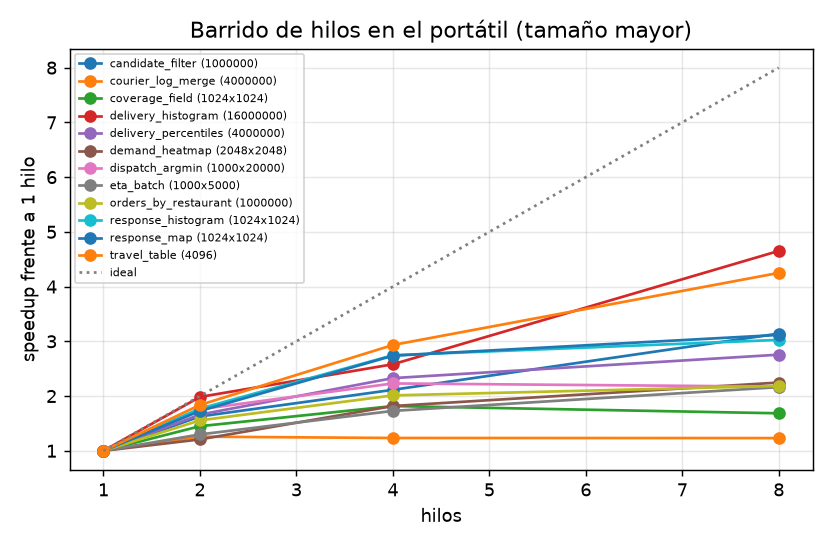

  - **Ninguna aplicación escala de forma ideal.** Con 8 hilos, la mejor es el histograma (4,6×), seguida de la tabla de viajes (4,3×) y el filtro (3,1×). La mayoría se queda entre 1,7× y 2,8×, y la mezcla apenas llega a 1,2×.
  - **De 4 a 8 hilos casi no se gana:** el i5-1135G7 tiene 4 núcleos físicos, y los 4 hilos extra son *hyperthreading*, que comparten las unidades de cálculo y la caché de cada núcleo.
  - **Las aplicaciones que mueven muchos datos por operación** (convolución, stencil, agrupación, ETA) se estancan pronto, probablemente porque todos los hilos comparten el mismo ancho de banda de memoria (en el stencil lo agrava además la barrera de hilos de cada barrido). Esa es la referencia de CPU que la GPU tiene que superar.

### 2.4 Cómo reproducir cada número

```bash
# Portátil (WSL2)
cmake -S . -B build -DCMAKE_BUILD_TYPE=Release -DENABLE_VIEWER=OFF && cmake --build build -j
./build/delivery_sim config/city.json --headless --bench laptop_results.csv
lscpu

# Colab (T4): notebook 17-mediciones-finales
cmake -S . -B build -DCMAKE_BUILD_TYPE=Release -DUSE_CUDA=ON -DENABLE_VIEWER=OFF && cmake --build build -j
nvidia-smi --query-gpu=name,driver_version,clocks.max.sm,clocks.max.mem,memory.total --format=csv
./build/delivery_sim config/city.json --headless --bench colab_results.csv
cmake -S . -B ptx -DUSE_CUDA=ON -DCMAKE_CUDA_FLAGS=-Xptxas=-v && cmake --build ptx --target delivery_gpu
nsys profile -o timeline ./build/delivery_sim city_short.json --headless
nsys stats --report cuda_gpu_kern_sum,cuda_gpu_mem_time_sum,cuda_api_sum timeline.nsys-rep
ncu --section SpeedOfLight --section Occupancy --section LaunchStats -k regex:<kernel> -c 1 \
    ./build/delivery_sim config/city.json --headless --bench x.csv --bench-once --bench-only <app> --bench-size <tamaño>
compute-sanitizer --tool memcheck ./build/tests/delivery_tests
compute-sanitizer --tool racecheck ./build/tests/delivery_tests
./build/delivery_sim config/city.json --headless [--cpu-only] --log sim.log   # 1 hora simulada
python3 tools/sim_effect.py gpu=sim_gpu.log cpu=sim_cpu.log
python3 tools/gpu_report.py --laptop laptop_results.csv --colab colab_results.csv --out figuras

# Frecuencia de cuadros con ventana (portátil, WSL2 con WSLg)
cmake -S . -B build-viewer -DCMAKE_BUILD_TYPE=Release -DENABLE_VIEWER=ON && cmake --build build-viewer -j
./build-viewer/delivery_sim config/city.json --log sim.log --frame-log frames_laptop_city.csv
./build-viewer/delivery_sim config/city.json --heatmap --log sim.log --frame-log frames_laptop_city_lock.csv

# Colab (T4): notebook 18-fps-aos-soa, ventana sobre la pantalla virtual Xvfb
cmake -S . -B build -DCMAKE_BUILD_TYPE=Release -DUSE_CUDA=ON -DENABLE_VIEWER=ON && cmake --build build -j
xvfb-run -a -s "-screen 0 1280x800x24" ./build/delivery_sim config/city.json \
    [--cpu-only | --gpu-dispatch measured | --gpu-dispatch always] --log sim.log --frame-log frames.csv
python3 tools/sim_effect.py cpu=sim_cpu.log measured=sim_measured.log always=sim_always.log
python3 tools/fps_report.py --data datos/fps --out figuras/fps_frames.png
ncu --metrics gpu__time_duration.sum,dram__bytes_read.sum,dram__bytes_write.sum,lts__t_bytes.sum,\
l1tex__t_requests_pipe_lsu_mem_global_op_ld.sum,l1tex__t_sectors_pipe_lsu_mem_global_op_ld.sum,\
l1tex__t_bytes_pipe_lsu_mem_global_op_ld.sum -k regex:etaKernelSoA -c 1 \
    ./build/delivery_sim config/city.json --headless --bench x.csv --bench-once --bench-only eta_batch --bench-size 1000x5000

# Colab (T4): notebook 19-validar-ventana, dibujo simplificado y mapa de calor
xvfb-run -a -s "-screen 0 1280x800x24" ./build/delivery_sim config/city.json --heatmap \
    --screenshot ventana.png --frame-log frames_colab_city_dense_heatmap.csv --log sim.log
compute-sanitizer --tool memcheck ./build/tests/delivery_tests

# ThreadSanitizer (portátil, WSL2)
cmake -S . -B build-tsan -DENABLE_TSAN=ON -DENABLE_VIEWER=OFF && cmake --build build-tsan -j
./build-tsan/tests/delivery_tests && ./build-tsan/delivery_sim config/equipetrol.json --headless
```

### 2.5 Integración con el programa concurrente
- **Un solo hilo es dueño de la GPU** (`concurrency::GpuWorker`). El resto de hilos le envían encargos por una cola protegida (`mutex` + `condition_variable`) y reciben un `std::future`. El despachador espera con `wait_until(now + quoteTimeoutMs)`: si la GPU no responde a tiempo, calcula en la CPU y el pedido no espera.
- **Todo lo que se hace en la GPU tiene una versión equivalente en la CPU.** Sin CUDA (`USE_CUDA=OFF`, la opción por defecto), los mismos `.cu` se compilan como C++ a través de `cuda_compat.h`, y el simulador usa las versiones de CPU.
- **Invariantes:** la GPU solo **propone** (un candidato, una ETA, una estadística). La asignación la confirma `Courier::tryAssign` bajo el candado del repartidor, igual que antes. Así se cierra la ventana de "comprobar y luego actuar": si el repartidor elegido dejó de estar libre, el despachador vuelve a elegir.

---

## 3. Aplicaciones

**Notación de todas las tablas:**
- "CPU N": la mejor de 2, 4 u 8 hilos en el portátil, indicando qué N fue.
- "Misma máquina": la CPU de Colab (2 vCPU) frente a la T4.

**Análisis común a todos los kernels (lanzamiento, warps, ocupación):**
- Las configuraciones de bloque son múltiplos de 32 (256 o 1.024 hilos), así que no hay warps incompletos salvo en el último bloque.
- La ocupación **teórica** es del **100 %** en los 11 kernels perfilados (32 warps por SM). Los límites por bloque aparecen en la tabla del apartado 4.2.

### 3.1 Tiling: tabla de tiempos de viaje (`03_memory_tiling`)

**Tarea:** calcular la distancia mínima entre todas las parejas de intersecciones, una vez al arrancar. El despachador la consulta en cada estimación. Cada celda `(i, j)` de cada bloque se actualiza de forma independiente dentro de su fase, y por eso es paralelismo de datos.

**Diseño:**
- Floyd–Warshall en tres fases por cada pivote `k`:
  1. El bloque dependiente `(k, k)`, resuelto por 1 bloque de hilos.
  2. La fila y la columna del pivote, con una cuadrícula de `tiles × 2`.
  3. Todos los demás bloques, con una cuadrícula de `tiles × tiles`.
- Bloques de 32 × 32 enteros (en centímetros) en memoria compartida. La fase 3 es una "multiplicación de matrices" con mínimo y suma (*min-plus*).
- Bloques de 1.024 hilos (32 × 32): una celda por hilo, y `threadIdx.x` recorre columnas contiguas, así que el acceso es coalescido.

**Correctitud:** la tabla es **idéntica** a la de un Dijkstra desde cada nodo (enteros, sin tolerancia). Se comprueba con sentidos únicos y nodos inalcanzables (`test_travel_table.cpp`). `compute-sanitizer` da 0 errores.

| Nodos | CPU 1 (ms) | CPU N (ms) | GPU kernel | GPU e2e | Speedup (kernel / e2e) | ¿Correcto? |
|---|---|---|---|---|---|---|
| 36 | 0,034 | 0,034 (N=1) | 0,090 | 0,405 | 0,4× / 0,08× | sí |
| 144 | 0,792 | 0,444 (N=4) | 0,204 | 0,546 | 2,2× / 0,81× | sí |
| 576 | 13,8 | 2,98 (N=8) | 1,24 | 2,80 | 2,4× / 1,06× | sí |
| 1.024 | 51,0 | 12,7 (N=8) | 6,59 | 13,7 | 1,9× / 0,93× | sí |
| 2.304 | 263 | 54,3 (N=8) | 40,4 | 85,1 | 1,3× / 0,64× | sí |
| 4.096 | 891 | 210 (N=8) | 292 | 331 | 0,7× / 0,63× | sí |

En la misma máquina (Colab), la CPU con 2 hilos tarda 1.041 ms con 4.096 nodos frente a 331 ms de la GPU de extremo a extremo (3,1×).

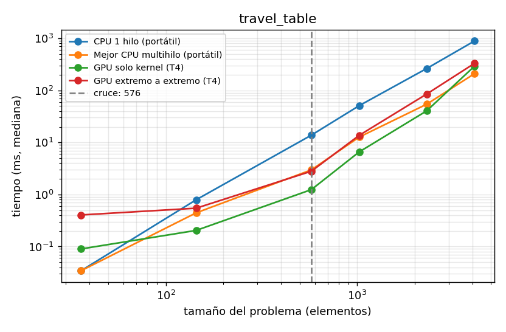 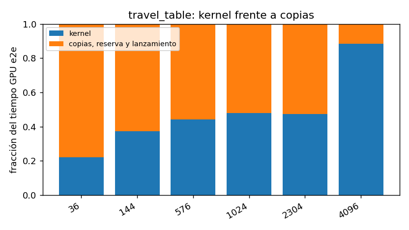

**Análisis:**
- **Paralelismo:** con 4.096 nodos, la fase 3 lanza 128² = 16.384 bloques de 1.024 hilos (409 oleadas por SM): la GPU está llena. Con 36 nodos solo hay 1 bloque, que usa 1 de los 40 SMs.
- **Limitado por memoria o por cálculo:**
  - `ncu` (fase 3, 4.096 nodos): **Compute (SM) 76 %, L1/memoria compartida 89 %, DRAM 19 %**. Es un kernel equilibrado y limitado por la memoria compartida, no por la DRAM.
  - La intensidad aritmética derivada es de 4 operaciones por byte: cada bloque hace 32³ operaciones mínimo-suma con 16 KB de tráfico global. Sin tiling serían 0,25 operaciones por byte.
  - Rendimiento alcanzado: unos **470 Gop/s** (figura del *roofline*).
- **Ocupación:** 30 registros y 8 KB de memoria compartida por bloque. El límite real es el número de **warps** (1 bloque de 1.024 hilos por SM). Ocupación lograda: **97,9 %**.
- **Divergencia:** ninguna. Los bloques de la fila o columna del pivote salen con `return` por bloque completo.
- **Sobrecostes:** con 4.096 nodos, las copias (67 MB de ida y de vuelta) son el 12 % del tiempo e2e. `nsys` en la simulación: el 92 % del tiempo de GPU es esta fase 3 (128 lanzamientos).
- **Por qué pierde frente al portátil:** Floyd–Warshall hace n³ ≈ 6,9·10¹⁰ operaciones, mientras que Dijkstra en un grafo con unas 4 calles por intersección hace del orden de n·m·log n ≈ 10⁹. La GPU ejecuta muy bien un algoritmo **30–60 veces más caro**.
- **Veredicto:** **mantener la CPU** (Dijkstra multihilo) para la ciudad. La GPU solo gana en la franja de 576 a 1.024 nodos, y por poco (1,06×). Como la tabla se calcula una sola vez al arrancar, la diferencia no afecta a la simulación.

### 3.2 Coalescencia, AoS frente a SoA: ETA por lotes (`04_performance`)

**Tarea:** el tiempo estimado de entrega (ETA) de cada pareja pedido × repartidor. Son cálculos independientes: 5 millones con 1.000 × 5.000.

**Diseño:**
- La tabla de distancias se sube a la GPU **una sola vez** (`EtaEngine`).
- La flota se copia como **estructura de arrays** (SoA): `node[]`, `stops[k·C + c]`, `latestReadyAtMs[]`, `cmPerSecond[]`.
- Rejilla 2D: `blockIdx.y` es el pedido y `x` el repartidor, con bloques de 256 hilos.
- La fórmula de la ETA es una sola función `__host__ __device__` con aritmética entera, compartida por la CPU y la GPU.
- Una variante AoS (`CourierRecord` de 32 B) permite comparar las dos organizaciones.

**Correctitud:** la CPU (1 y 3 hilos), el kernel SoA y el kernel AoS dan **la misma matriz bit a bit** (`test_eta_batch.cpp`).

| Pedidos × repartidores | CPU 1 | CPU N | GPU kernel (SoA) | GPU e2e (matriz) | GPU e2e (ETA + argmin) | Speedup (kernel / e2e) | ¿Correcto? |
|---|---|---|---|---|---|---|---|
| 10 × 50 | 0,009 | 0,009 (N=1) | 0,010 | 0,248 | 0,277 | 0,9× / 0,04× | sí |
| 50 × 200 | 0,146 | 0,146 (N=1) | 0,016 | 0,307 | 0,286 | 9,0× / 0,48× | sí |
| 100 × 500 | 1,38 | 0,691 (N=4) | 0,053 | 0,446 | 0,370 | 13,1× / 1,55× | sí |
| 200 × 1.000 | 6,53 | 2,88 (N=8) | 0,189 | 1,07 | 0,532 | 15,2× / 2,71× | sí |
| 500 × 2.000 | 34,9 | 14,6 (N=8) | 0,795 | 3,64 | 1,68 | 18,4× / 4,02× | sí |
| 1.000 × 5.000 | 181 | 83,8 (N=8) | 3,16 | 32,8 | **5,60** | 26,5× / 2,55× (**15,0×** con argmin) | sí |

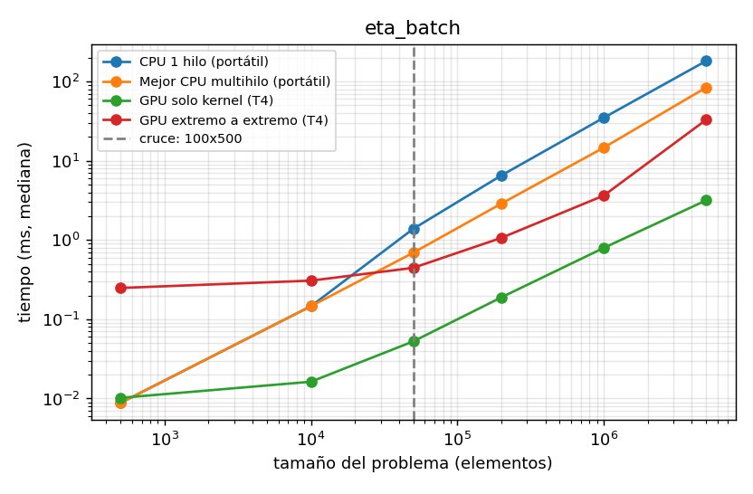 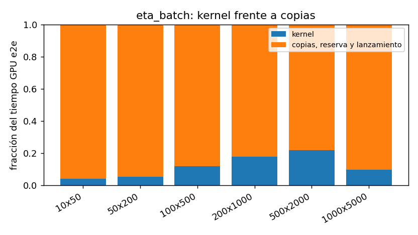

**AoS frente a SoA: bytes movidos y ancho de banda efectivo** (`ncu --metrics`, un lanzamiento por kernel; datos en `datos/ncu/ncu_bytes_*.txt`):

| Pares | Organización | Kernel (ms) | DRAM leído + escrito (MB) | Ancho de banda DRAM efectivo | Tráfico L2 (MB) | Bytes cargados en L1 (MB) | Sectores por petición de lectura |
|---|---|---|---|---|---|---|---|
| 200 × 1.000 | SoA | 0,187 | 40,5 + 3,0 = 43,5 | 232 GB/s | 25,3 | 27,5 | **8,96** |
| 200 × 1.000 | AoS | 0,185 | 40,5 + 3,0 = 43,6 | 236 GB/s | 30,0 | 56,8 | **18,48** |
| 1.000 × 5.000 | SoA | 3,17 | 680,3 + 50,2 = 730,5 | 230 GB/s | 683,6 | 674,6 | **8,95** |
| 1.000 × 5.000 | AoS | 3,21 | 683,6 + 50,2 = 733,9 | 229 GB/s | 886,1 | 1.400 | **18,57** |

- **Ancho de banda efectivo** = bytes de DRAM (lectura + escritura) / tiempo del kernel. Los dos kernels trabajan al **~72 % de los 320 GB/s** de la T4.
- **La coalescencia sí cambia:** con AoS cada petición de lectura de un warp toca **el doble de sectores de 32 B** (18,5 frente a 9,0), y por la L1 pasan **2,1 veces más bytes** (1,40 GB frente a 0,67 GB). La L2 recibe un 30 % más de tráfico. Es justo lo que predice la teoría: los 32 hilos de un warp leen campos de 4 B separados por estructuras de 32 B (`CourierRecord`), en lugar de 32 enteros contiguos.
- **Pero el tiempo no cambia,** porque los bytes que llegan a la DRAM son prácticamente los mismos (730 frente a 734 MB). Los datos de la flota ocupan 5.000 × 32 B = 160 KB y **caben en la L2** (4 MB). Tras la primera lectura, el exceso de sectores del AoS se sirve desde la caché.
- **El tráfico de DRAM lo dominan las lecturas dispersas de la tabla de distancias** (`table[nodo·n + restaurante]`; la tabla ocupa 4.096² × 4 B = 64 MB y no cabe en la L2). Cada lectura trae un sector de 32 B para usar 4 B, y ninguna de las dos organizaciones puede hacerla coalescida. Lo único que se escribe es la matriz de salida: 5 millones × 8 B = 40 MB (1,25 millones de sectores de escritura).
- **Conclusión:** SoA es la organización correcta, porque reduce a la mitad las transacciones de L1 y ahorra un 23 % de tráfico de L2. Aquí, sin embargo, el límite está en los accesos dispersos a la tabla. Para ver la ganancia del SoA en tiempo haría falta una flota que no cupiera en la L2 (más de unos 130.000 repartidores) o un kernel que no leyera la tabla.

**Análisis:**
- **Ocupación:** 30 registros por hilo, sin memoria compartida. Límite por warps, ocupación lograda del **90 %**.
- **Divergencia:** el bucle de paradas depende del tamaño de la bolsa de cada repartidor (0 a 3). Es moderada y acotada a 4 iteraciones.
- **Sobrecostes:** devolver la matriz de 40 MB (1.000 × 5.000 × 8 B) es el 90 % del tiempo e2e. Si el argmin se hace en la GPU, solo vuelven 16 KB y el tiempo baja de 32,8 a 5,6 ms.
- **Veredicto:**
  - **Usar la GPU para lotes de unos 50.000 pares o más** (cruce frente al portátil: 100 × 500).
  - El despacho actual de **un pedido cada vez** (1 × 300 candidatos) queda por debajo del cruce, así que el despachador se queda en la CPU.
  - El umbral del código (`kGpuEtaMinPairs = 10.000`) se fijó con el cruce frente a la CPU de Colab. Frente al portátil, el cruce está más cerca de 50.000 pares.

### 3.3 Convolución: mapa de calor de la demanda (`05_conv`)

**Tarea:**
1. Contar los puntos de entrega de los pedidos creados en una rejilla de 64 × 64 sobre el mapa.
2. Suavizarla con un filtro gaussiano 5 × 5 (pesos binomiales enteros, que suman 256).
3. Informar de la celda con más demanda.

Cada celda de salida es independiente.

**Diseño:**
- Filtro en **memoria constante** (`__constant__ int heatFilter[25]`).
- Bloques de 16 × 16 que cargan en memoria compartida una zona de **20 × 20 con halo** (borde de 2 celdas). Fuera del mapa se rellena con 0.

**Correctitud:** con pesos enteros, la CPU y la GPU coinciden **exactamente** (`test_demand_heatmap.cpp`), y la tolerancia es 0.

| Rejilla | CPU 1 | CPU N | GPU kernel | GPU e2e | Speedup (kernel / e2e) | ¿Correcto? |
|---|---|---|---|---|---|---|
| 64 × 64 | 0,044 | 0,044 (N=1) | 0,014 | 0,226 | 3,0× / 0,19× | sí |
| 256 × 256 | 0,698 | 0,601 (N=8) | 0,028 | 0,422 | 21,7× / 1,43× | sí |
| 512 × 512 | 2,89 | 1,46 (N=8) | 0,065 | 0,996 | 22,5× / 1,47× | sí |
| 1.024 × 1.024 | 11,8 | 5,15 (N=8) | 0,217 | 2,95 | 23,7× / 1,75× | sí |
| 2.048 × 2.048 | 49,2 | 21,9 (N=8) | 0,824 | 11,6 | 26,6× / 1,89× | sí |

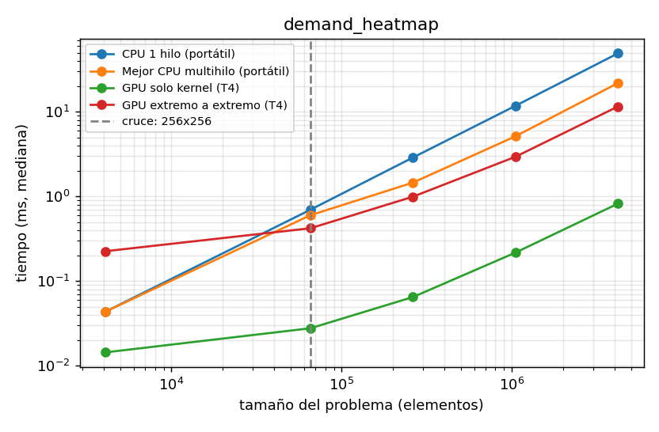 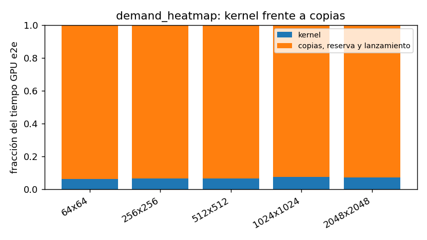

**En la ventana (capa del mapa de calor):**
- Con la tecla `h` (o con `--heatmap` desde el inicio), la ventana dibuja el mapa de calor encima del mapa. Por defecto está oculto, para no alterar las mediciones de FPS del apartado 5.2.
- Cada segundo, el hilo de la ventana cuenta los **últimos 1.000 pedidos creados** en la rejilla de 64 × 64 (`core::binPoints`) y **envía** el suavizado al hilo dueño de la GPU. **No espera el resultado:** en cada cuadro consulta el `future` con `wait_for(0)` y, cuando está listo, cambia la capa. Sin GPU (o con `--cpu-only`), suaviza en la CPU.
- La rejilla suavizada se normaliza a 0–255, se colorea (`COLORMAP_JET`), se escala al tamaño del mapa y se mezcla con transparencia del 45 % solo donde hay demanda.
- **Coste medido en el portátil** (`datos/fps/frames_summary.txt`): en Equipetrol el dibujo pasa de 1,0 a 1,6–1,7 ms por cuadro (27,7–27,8 FPS frente a 28,4). En la ciudad, dos ejecuciones con la capa dieron 7,3 y 9,8 FPS frente a 9,9 sin ella: la diferencia está dentro de la variabilidad de esa escala.

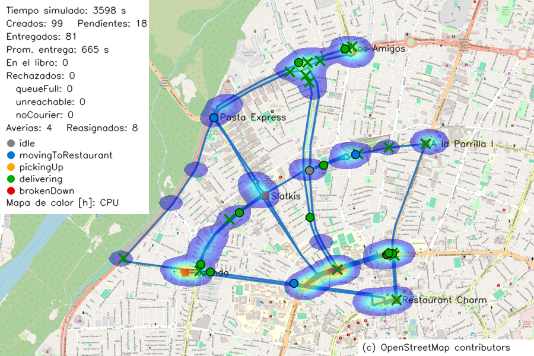

*Último cuadro de una simulación de Equipetrol (1 hora simulada) con la capa activada (`--heatmap --screenshot`). Las zonas rojas y amarillas concentran los destinos de los pedidos recientes.*

**Análisis:**
- **`ncu`** (2.048²): **L1/memoria compartida 91 %, DRAM 18 %, SM 47 %**.
  - El halo en memoria compartida evita que la DRAM sea el límite: cada celda se lee unas 1,56 veces de memoria global en lugar de 25.
  - La memoria constante **difunde** cada peso a los 32 hilos del warp en una sola lectura.
  - Intensidad derivada: unas 4,9 operaciones por byte. Rendimiento alcanzado: unos 255 Gop/s.
- **Ocupación:** 33 registros y 1,6 KB de memoria compartida. Límite por warps, ocupación lograda del **95,8 %**.
- **Divergencia:** solo en los bloques del borde (carga del halo y la condición `outX < width`).
- **Sobrecostes:** el kernel es 26 veces más rápido que la mejor CPU, pero las copias suponen el 93 % del tiempo e2e con 2.048².
- **Veredicto:** con la rejilla de la simulación (64², 0,04 ms en la CPU) **mantener la CPU**. Con rejillas finas recalculadas a menudo (256² o más), **usar la GPU**.

### 3.4 Stencil: campo de cobertura de los repartidores (`06_stencil`)

**Tarea:**
1. Contar los repartidores por celda (la fuente) y difundir esa densidad con 200 iteraciones de Jacobi de 5 puntos.
2. Informar de la celda interior peor cubierta, que es donde convendría que esperaran los repartidores libres.

Todas las celdas de un barrido son independientes.

**Diseño:**
- Dos búferes que se intercambian tras cada barrido. Las celdas del borde quedan fijas en 0.
- Bloques de 16 × 16 que cargan una zona de 18 × 18 (halo de 1) en memoria compartida.
- Un lanzamiento de kernel por barrido. El final de cada kernel actúa como sincronización global entre barridos.
- Los datos se quedan en la GPU durante todos los barridos: solo hay una copia de ida y una de vuelta.

**Correctitud:** la operación es `((((n+s)+e)+w)+fuente) × 0,25` en el mismo orden en ambas versiones, sin ninguna `a·b+c` que el compilador pueda fusionar en una FMA. Por eso los `float` son **idénticos bit a bit** y los tests comparan con `==`. La tolerancia declarada es 0.

| Rejilla (100 barridos) | CPU 1 | CPU N | GPU kernel | GPU e2e | Speedup (kernel / e2e) | ¿Correcto? |
|---|---|---|---|---|---|---|
| 32 × 32 | 0,151 | 0,151 (N=1) | 0,580 | 0,856 | 0,3× / 0,18× | sí |
| 128 × 128 | 2,35 | 2,35 (N=1) | 0,622 | 0,946 | 3,8× / 2,48× | sí |
| 256 × 256 | 8,60 | 8,04 (N=2) | 1,05 | 1,60 | 7,7× / 5,04× | sí |
| 512 × 512 | 35,1 | 21,6 (N=4) | 2,79 | 3,96 | 7,7× / 5,45× | sí |
| 1.024 × 1.024 | 151 | 83,0 (N=4) | 12,6 | 15,7 | 6,6× / 5,29× | sí |

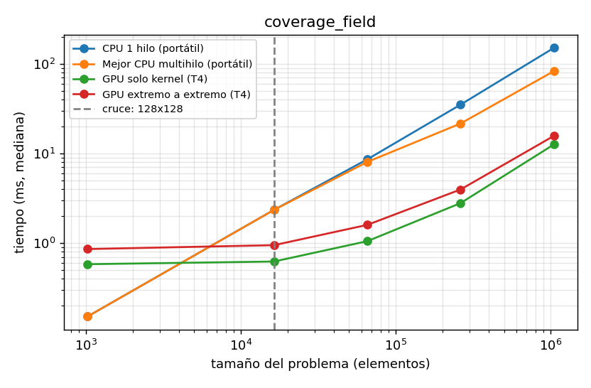 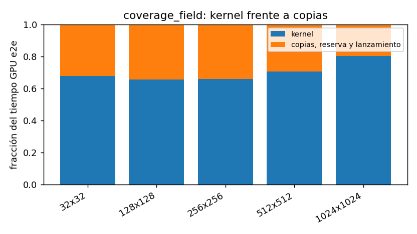

**Análisis:**
- **`ncu`** (1.024², un barrido): **DRAM 41 %, SM 32 %, L1 55 %**. El barrido dura 125 µs y está limitado por la **latencia**: la intensidad es de 5 operaciones por unos 13 B (0,38 op/B) y hay pocos bloques por SM para ocultar las esperas.
- **Ocupación:** 36 registros y 1,3 KB de memoria compartida. Límite por warps, ocupación lograda del **94,6 %**.
- **Sobrecostes:** con 32², los 100 lanzamientos (unos 5 µs cada uno según `nsys`) dominan y la CPU gana. Desde 128², el trabajo se amortiza y **las copias solo son entre el 20 y el 35 % del tiempo e2e**, porque los datos se reutilizan 100 veces en la GPU.
- **La CPU multihilo escala poco:** se pasa de 151 a 83 ms con 4 hilos, y con 8 empeora. El stencil también está limitado por la memoria en la CPU y obliga a una barrera de hilos en cada barrido.
- **Veredicto:** **usar la GPU desde 128²**. Es el mejor caso del proyecto: unas 5,4 veces más rápido de extremo a extremo frente al portátil.

### 3.5 Histograma con atómicos y privatización: tiempos de entrega (`07_histogram`)

**Tarea:** el histograma de las duraciones de entrega, con un intervalo por minuto (128 intervalos). Se calcula al final de la simulación.

**Diseño:**
- Una rejilla fija de 160 bloques (4 por SM) recorre los datos con un bucle de paso fijo (*grid-stride loop*).
- Cada bloque cuenta en un **histograma privado en memoria compartida** con `atomicAdd` y al final vuelca sus intervalos no nulos al histograma global.

**Correctitud:** los conteos son idénticos a una pasada en la CPU y el total coincide con el número de entregas (`test_delivery_histogram.cpp`).

| Entregas | CPU 1 | CPU N | GPU kernel | GPU e2e | Speedup (kernel / e2e) | ¿Correcto? |
|---|---|---|---|---|---|---|
| 10.000 | 0,014 | 0,014 (N=1) | 0,013 | 0,240 | 1,1× / 0,06× | sí |
| 100.000 | 0,138 | 0,138 (N=1) | 0,016 | 0,470 | 8,6× / 0,29× | sí |
| 1.000.000 | 4,58 | 1,40 (N=8) | 0,045 | 2,39 | 31,1× / 0,59× | sí |
| 4.000.000 | 14,7 | 2,87 (N=8) | 0,156 | 9,41 | 18,4× / 0,31× | sí |
| 16.000.000 | 45,0 | 9,67 (N=8) | 0,558 | 36,0 | 17,3× / 0,27× | sí |

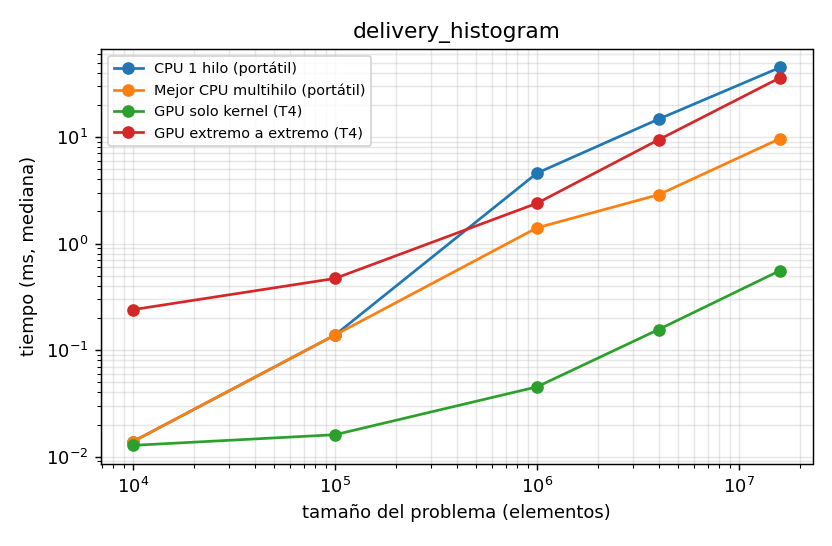 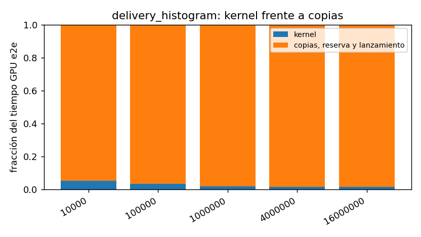

**El resultado en la simulación:** el simulador imprime al terminar el histograma calculado por `privatizedHistogram` y los percentiles calculados por el radix sort (`datos/sim/resultados_gpu_ciudad.txt`, ejecución de la ciudad en la T4). `tools/histogram_plot.py` los dibuja:

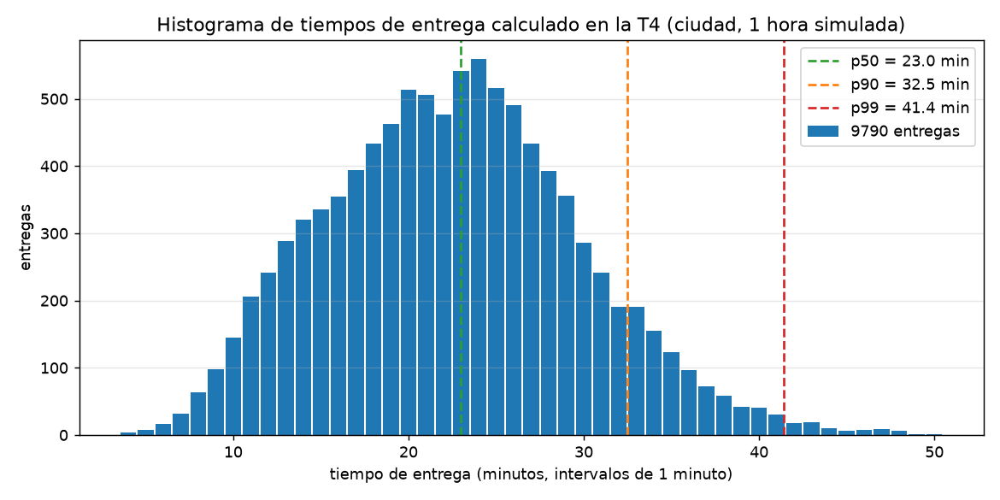

*9.790 entregas en 1 hora simulada de la ciudad. La mediana es de 23 minutos y el 1 % más lento supera los 41 minutos. Los 128 intervalos de 1 minuto cubren de sobra el rango observado (4 a 50 minutos).*

**Análisis:**
- **`ncu`** (16 millones): **DRAM 91 %**, es decir, el kernel trabaja en el techo de ancho de banda.
- **Contención:** los atómicos en memoria compartida **no** son el límite (SM 36 %). La privatización reduce los atómicos globales a 160 × 128 como máximo, aunque las entregas se concentran en pocos minutos.
- **Ocupación:** 22 registros, 512 B de memoria compartida, ocupación lograda del 98,5 %.
- **Sobrecostes:** cada entrega cuesta 8 B de copia por PCIe y solo una operación, así que **las copias son más del 98 %** del tiempo e2e.
- **Veredicto:** **mantener la CPU**. Solo convendría la GPU si las duraciones ya estuvieran en la memoria de la GPU.

### 3.6 Reducción: argmin del despachador (`08_reduction`)

**Tarea:** elegir, para cada pedido, el repartidor de menor ETA, con desempate determinista por `(eta, índice)`.

**Diseño:**
- Un bloque de 256 hilos por pedido.
- Cada hilo recorre su fila de 256 en 256 columnas (*coarsening*) y después hay una **reducción en árbol convergente** en memoria compartida.
- Sin atómicos: el resultado no depende del orden en que terminen los hilos.

**Correctitud:** con muchos empates forzados (ETA de solo 5 valores posibles), el kernel elige exactamente igual que la CPU (`test_argmin_reduction.cpp`).

| Pedidos × repartidores | CPU 1 | CPU N | GPU kernel | GPU e2e (sube la matriz) | Speedup (kernel / e2e) | ¿Correcto? |
|---|---|---|---|---|---|---|
| 10 × 500 | 0,005 | 0,005 (N=1) | 0,016 | 0,242 | 0,3× / 0,02× | sí |
| 200 × 5.000 | 1,02 | 0,649 (N=4) | 0,057 | 2,47 | 11,5× / 0,26× | sí |
| 1.000 × 5.000 | 4,58 | 2,17 (N=8) | 0,208 | 11,1 | 10,4× / 0,20× | sí |
| 1.000 × 20.000 | 16,9 | 7,56 (N=4) | 0,640 | 40,6 | 11,8× / 0,19× | sí |

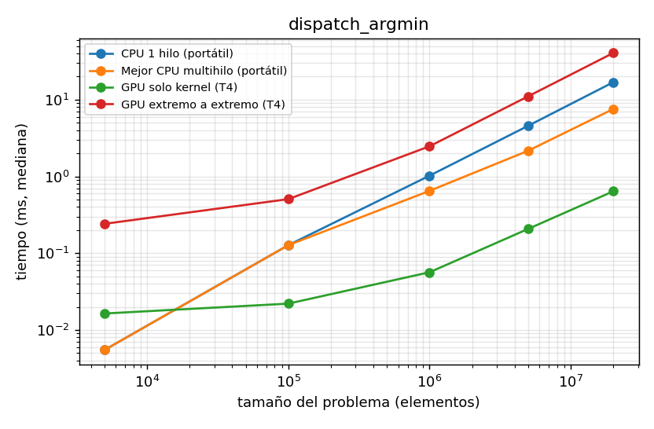 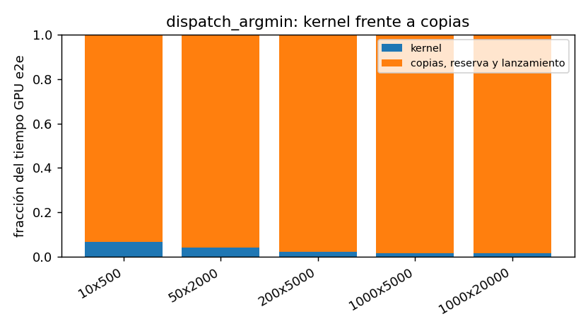

**Análisis:**
- **`ncu`** (1.000 × 20.000): **DRAM 94,9 %**. El kernel está en el techo de ancho de banda: alcanza unos 250 GB/s efectivos de los 320 GB/s de la T4.
- **Ocupación:** 64 registros por hilo (límite de 4 bloques por registros, que coincide con el límite por warps). Ocupación lograda del **98,9 %**.
- **Paralelismo:** con 10 pedidos solo hay 10 bloques para 40 SMs, así que la GPU queda vacía.
- **Sobrecostes:** el argmin lee cada valor **una sola vez** (0,12 op/B). Subir la matriz por PCIe cuesta entre 40 y 60 veces más que recorrerla.
- **Veredicto:** **solo** en la GPU **encadenado** con la ETA, cuando la matriz ya está en la GPU (`EtaEngine::bestPerOrder`, tabla 3.2: de 32,8 a 5,6 ms). Por separado, CPU.

### 3.7 Scan: entregas agrupadas por restaurante (`09_scan`)

**Tarea:** agrupar las entregas por restaurante de forma estable (ordenación por conteo), para obtener estadísticas por restaurante.

**Diseño:**
1. Conteo por bloque y restaurante en memoria compartida, que forma una matriz `restaurante × bloque` guardada por restaurante.
2. ***Scan* exclusivo jerárquico** de esa matriz: Kogge–Stone en trozos de 512, *scan* de las sumas de cada trozo y suma de los desplazamientos.
3. Escritura estable usando el rango local de cada entrega dentro de su bloque.

**Correctitud:** el resultado es igual a un `std::stable_sort` por clave con 1, 7 y 60 restaurantes (`test_group_by_key.cpp`).

| Entregas | CPU 1 | CPU N | GPU kernel | GPU e2e | Speedup (kernel / e2e) | ¿Correcto? |
|---|---|---|---|---|---|---|
| 10.000 | 0,020 | 0,020 (N=1) | 0,043 | 0,309 | 0,5× / 0,06× | sí |
| 100.000 | 0,191 | 0,191 (N=1) | 0,075 | 0,715 | 2,6× / 0,27× | sí |
| 300.000 | 0,651 | 0,651 (N=1) | 0,148 | 1,69 | 4,4× / 0,39× | sí |
| 1.000.000 | 6,97 | 3,19 (N=8) | 0,409 | 5,67 | 7,8× / 0,56× | sí |

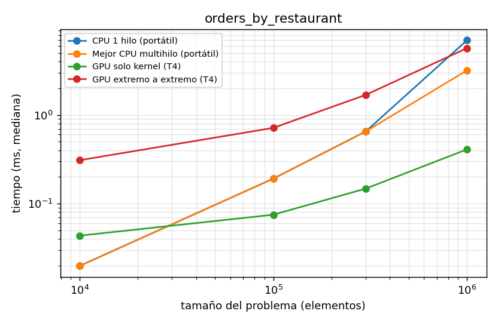 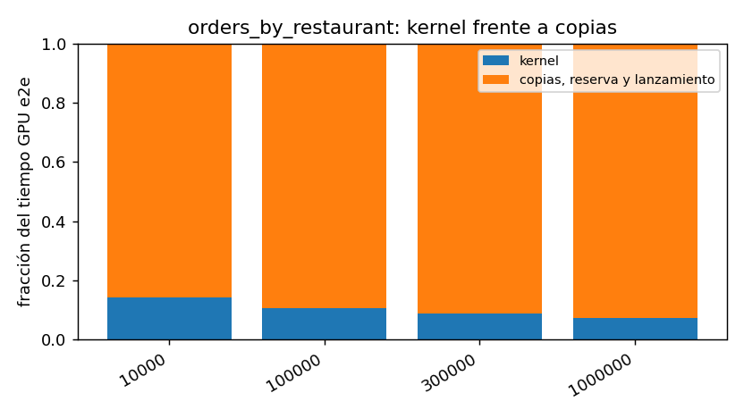

**Análisis:**
- **`ncu`** (`scatterByKey`, 1 millón): **SM 83,5 %**, limitado por el cálculo. El rango local se calcula con un bucle de hasta 255 comparaciones en memoria compartida por hilo.
- **Ocupación lograda:** solo el **72 %**, por desequilibrio. Los hilos del final del bloque comparan más que los del principio.
- La ordenación por conteo en la CPU es muy barata: una pasada para contar y otra para escribir.
- **Veredicto:** **mantener la CPU**.
- **Mejora posible:** calcular el rango local con un `__ballot_sync` por restaurante dentro de cada warp, en lugar del bucle.

### 3.8 Filtro: candidatos dentro de un radio (`10_filter`)

**Tarea:** quedarse con los repartidores disponibles a menos de 2 km del restaurante, en orden estable, antes de calcular las ETA.

**Diseño:**
- Coordenadas en **decímetros enteros**, para que `dx² + dy² ≤ r²` sea exacto y no dependa de cómo redondee la FMA.
- Tres kernels: conteo por bloque, *scan* de esos conteos y escritura con un *scan* de Kogge–Stone en memoria compartida.

**Correctitud:** mismo conjunto y mismo orden que la CPU, también justo en los bordes de bloque (1, 255, 256, 257 y 1.000) (`test_candidate_filter.cpp`).

| Repartidores | CPU 1 | CPU N | GPU kernel | GPU e2e | Speedup (kernel / e2e) | ¿Correcto? |
|---|---|---|---|---|---|---|
| 1.000 | 0,005 | 0,005 (N=1) | 0,019 | 0,301 | 0,3× / 0,02× | sí |
| 16.000 | 0,107 | 0,107 (N=1) | 0,019 | 0,336 | 5,6× / 0,32× | sí |
| 64.000 | 0,389 | 0,330 (N=4) | 0,024 | 0,486 | 13,6× / 0,68× | sí |
| 256.000 | 1,59 | 0,726 (N=8) | 0,045 | 1,15 | 16,1× / 0,63× | sí |
| 1.000.000 | 5,80 | 1,85 (N=8) | 0,177 | 3,16 | 10,4× / 0,58× | sí |

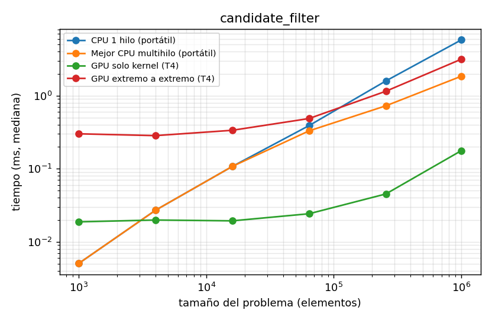 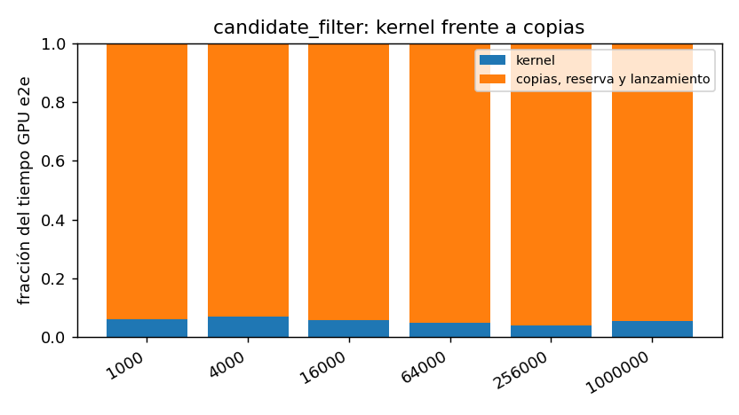

**Análisis:**
- **`ncu`** (`scatterInside`, 1 millón): **SM 69 %, L1 82 %**, dominado por el *scan* en memoria compartida. Ocupación lograda del 94 %.
- **Divergencia:** solo en `if (keep)`, una escritura.
- **Sobrecostes:** con 1 millón se copian 9 MB a la GPU y 4 MB de vuelta, y eso es el 94 % del tiempo e2e. Con la flota real (3.000 repartidores) el filtro cuesta 0,02 ms en la CPU frente a 0,3 ms en la GPU.
- **Veredicto:** **mantener la CPU**. El umbral `kGpuFilterMinCouriers = 64.000` impide usar la GPU en la ciudad.

### 3.9 Merge: línea de tiempo a partir de los registros por repartidor (`11_merge`)

**Tarea:**
1. Cada repartidor tiene su propio segmento ordenado de entregas.
2. Los segmentos se mezclan de forma **estable**: con el mismo instante, primero va el repartidor de índice menor.
3. Con la línea de tiempo global se calcula la ventana de 10 minutos con más entregas.

**Diseño:**
- Rondas de mezcla por parejas (12 rondas para 3.000 segmentos).
- Cada hilo produce 8 posiciones de salida. Localiza su pareja y su punto de partida con **búsquedas binarias** (*co-rank*) y desde ahí mezcla de forma secuencial, con `A[i] ≤ B[j]` para que sea estable.

**Correctitud:** el resultado es igual a un `std::stable_sort`, incluso con empates y segmentos vacíos (`test_segment_merge.cpp`).

| Eventos (3.000 segmentos) | CPU 1 | CPU N | GPU kernel | GPU e2e | Speedup (kernel / e2e) | ¿Correcto? |
|---|---|---|---|---|---|---|
| 10.000 | 0,506 | 0,506 (N=1) | 0,389 | 1,22 | 1,3× / 0,42× | sí |
| 100.000 | 4,97 | 4,06 (N=4) | 0,684 | 2,42 | 5,9× / 1,68× | sí |
| 1.000.000 | 62,4 | 47,9 (N=4) | 6,85 | 16,0 | 7,0× / 2,99× | sí |
| 4.000.000 | 275 | 218 (N=2) | 22,1 | 57,1 | 9,9× / 3,82× | sí |

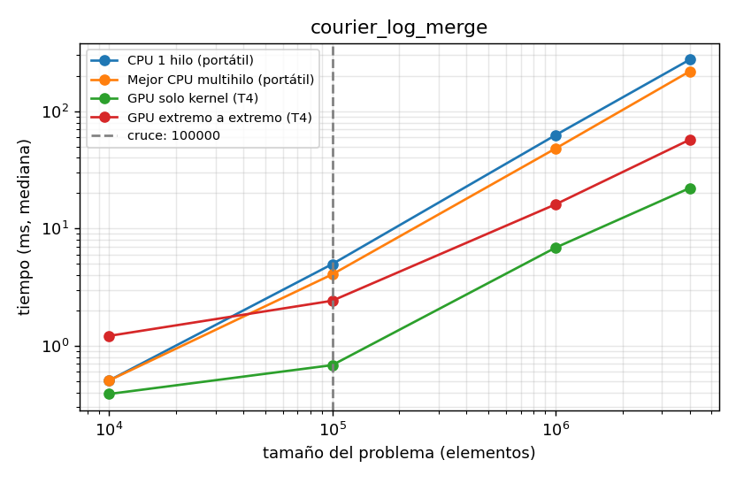 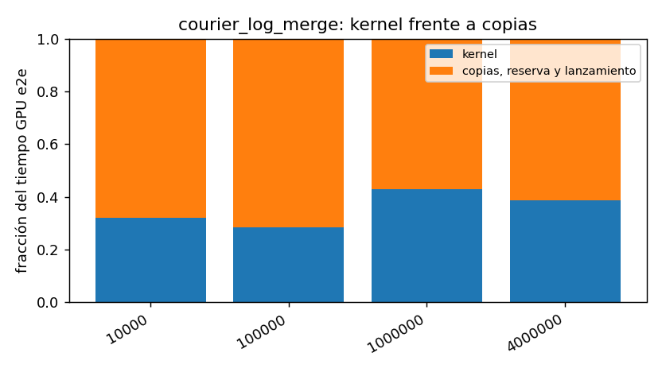

**Análisis:**
- **La CPU multihilo apenas escala:** de 275 a 218 ms. En las últimas rondas quedan pocas parejas (1 en la última), así que solo trabajan unos pocos hilos.
- **La GPU no tiene ese problema:** el *co-rank* reparte **cada pareja entre muchos hilos**, de modo que el paralelismo es el número de elementos entre 8, no el número de parejas.
- **`ncu`:** **L1 91 %, DRAM 52 %, SM 15 %**. El kernel está limitado por la latencia de las búsquedas binarias. Ocupación lograda del 83 %, por desequilibrio entre hilos.
- **Mejora posible:** cargar A y B por bloques en memoria compartida (*tiled merge*).
- **Veredicto:** **usar la GPU desde unos 100.000 eventos** (corridas largas o al repetir registros guardados).

### 3.10 Ordenación: percentiles de tiempo de entrega (`12_sorting`)

**Tarea:** ordenar las duraciones de entrega (claves `uint32`) y obtener p50, p90 y p99 por el método del rango más cercano.

**Diseño:**
- Radix sort de **1 bit por pasada**, solo sobre los bits necesarios (22 pasadas con duraciones de hasta unos 4·10⁶ ms).
- Cada pasada separa ceros y unos de forma estable: conteo por bloque, *scan* y escritura con Kogge–Stone.

**Correctitud:** el arreglo ordenado y los percentiles son idénticos a los de `std::sort`, y se comparan completos en cada repetición del bench.

| Entregas | CPU 1 | CPU N | GPU kernel | GPU e2e | Speedup (kernel / e2e) | ¿Correcto? |
|---|---|---|---|---|---|---|
| 10.000 | 0,399 | 0,381 (N=4) | 0,345 | 0,701 | 1,1× / 0,54× | sí |
| 100.000 | 4,90 | 2,19 (N=8) | 0,902 | 1,58 | 2,4× / 1,39× | sí |
| 1.000.000 | 59,9 | 22,3 (N=8) | 6,58 | 9,82 | 3,4× / 2,27× | sí |
| 4.000.000 | 272 | 98,7 (N=8) | 28,1 | 41,6 | 3,5× / 2,37× | sí |

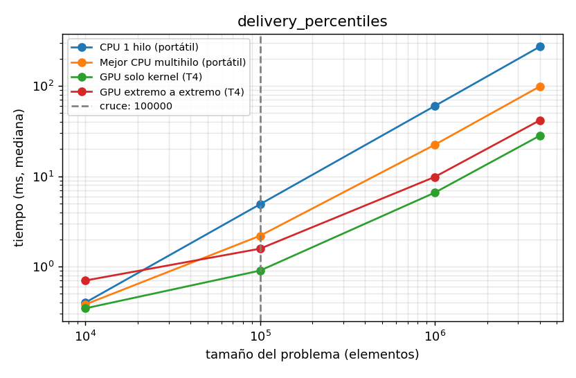 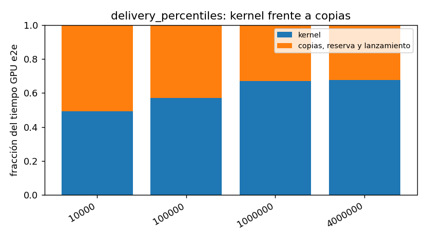

**Análisis:**
- **`ncu`** (`splitByBit`, 4 millones): **L1 91 %, SM 73 %, DRAM 31 %**, dominado por el *scan* en memoria compartida. Ocupación lograda del 92,7 %.
- **Sobrecostes:** como cada clave se procesa 22 veces en la GPU (una por pasada), copiar 16 MB se amortiza: **las copias son solo un 32 % del tiempo e2e**.
- **Mejora posible:** usar 4 u 8 bits por pasada dividiría el número de pasadas entre 4 u 8.
- **Veredicto:** **usar la GPU desde unas 100.000 entregas**.

---

## 4. Roofline y ocupación

### 4.1 Roofline

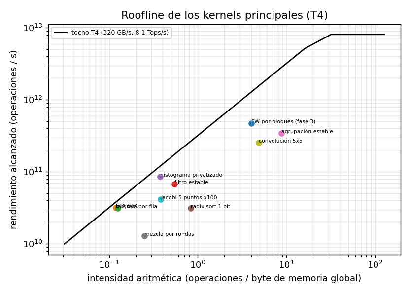

Los techos de la T4 son 320 GB/s de memoria y unas 8,1·10¹² operaciones por segundo. La intensidad aritmética de cada kernel se deriva **del código**, contando las operaciones y los bytes de memoria global por elemento (`ROOFLINE_MODELS` en `tools/gpu_report.py`). El rendimiento alcanzado es el número de operaciones dividido entre el tiempo del kernel en su tamaño mayor.

| Kernel | Tamaño | Operaciones/B | Gop/s alcanzados | Qué lo limita (`ncu`) |
|---|---|---|---|---|
| FW por bloques, fase 3 | 4.096 | 4,00 | 470 | Memoria compartida/L1 (89 %) y cálculo (76 %) |
| Agrupación estable (`scatterByKey`) | 1 M | 8,75 | 343 | Cálculo (SM 83 %) |
| Convolución 5 × 5 | 2.048² | 4,88 | 255 | Memoria compartida/L1 (91 %) |
| Histograma privatizado | 16 M | 0,38 | 86 | DRAM (91 %) |
| Filtro estable | 1 M | 0,55 | 68 | Memoria compartida/L1 (82 %) |
| Jacobi 5 puntos | 1.024² | 0,38 | 42 | Latencia (DRAM 41 %) |
| ETA SoA | 1.000 × 5.000 | 0,12 | 32 | DRAM (72 %), lecturas dispersas |
| Argmin por fila | 1.000 × 20.000 | 0,12 | 31 | DRAM (95 %) |
| Radix sort de 1 bit | 4 M | 0,83 | 31 | Memoria compartida/L1 (91 %) |
| Mezcla por rondas | 4 M | 0,25 | 13 | Latencia de las búsquedas binarias |

**Conclusiones:**
- **Siete de los diez kernels** están a la izquierda del punto de quiebre del *roofline* (unas 25 operaciones por byte), es decir, **limitados por la memoria**.
- Los tres que más se acercan a su techo son los que **reutilizan datos en memoria compartida**: tiling, convolución con halo y agrupación.
- Argmin e histograma están **en** el techo de DRAM: no se pueden acelerar más sin mover menos bytes.

### 4.2 Recursos y ocupación (`ptxas -v` y `ncu`)

| Kernel | Hilos/bloque | Registros/hilo | Memoria compartida/bloque | Límite (registros / memoria compartida / warps) | Ocupación teórica / lograda |
|---|---|---|---|---|---|
| `fwIndependentPhase` | 1.024 | 30 | 8 KB | 2 / 4 / **1** | 100 % / 97,9 % |
| `etaKernelSoA` | 256 | 30 | 0 | 8 / 16 / **4** | 100 % / 90,2 % |
| `etaKernelAoS` | 256 | 30 | 0 | 8 / 16 / **4** | 100 % / 89,8 % |
| `rowArgminKernel` | 256 | 64 | 3 KB | **4** / 10 / **4** | 100 % / 98,9 % |
| `privatizedHistogram` | 256 | 22 | 512 B | 10 / 64 / **4** | 100 % / 98,5 % |
| `splitByBit` | 256 | 16 | 1 KB | 16 / 32 / **4** | 100 % / 92,7 % |
| `scatterByKey` | 256 | 22 | 1 KB | 10 / 32 / **4** | 100 % / **72,2 %** (desequilibrio) |
| `scatterInside` | 256 | 18 | 1 KB | 10 / 32 / **4** | 100 % / 94,0 % |
| `mergePairsRound` | 256 | 34 | 0 | 6 / 16 / **4** | 100 % / 83,3 % (desequilibrio) |
| `smoothTiled` | 256 | 33 | 1,6 KB | 6 / 18 / **4** | 100 % / 95,8 % |
| `jacobiSweepTiled` | 256 | 36 | 1,3 KB | 6 / 21 / **4** | 100 % / 94,6 % |

- En todos los kernels el límite efectivo es el **número de warps** (1.024 hilos por SM), no los registros ni la memoria compartida. Por eso no hizo falta reducir registros.
- Los dos kernels con menor ocupación lograda pierden por **desequilibrio de carga**, no por recursos:
  - `scatterByKey`: el rango local tiene un coste distinto según la posición del hilo en el bloque.
  - `mergePairsRound`: las búsquedas binarias del *co-rank* tardan distinto según el hilo.
- **Nota:** `ncu` fija el reloj de los SM en unos 585 MHz para que las mediciones sean repetibles. Por eso sus duraciones no coinciden exactamente con las del bench.

### 4.3 Configuración de lanzamiento de cada kernel y por qué

**Cómo se lanza:** todos los kernels se lanzan con `launch(kernel, grid, block, args...)` (`include/delivery/gpu/cuda_compat.h`). Con `USE_CUDA=ON` equivale a `kernel<<<grid, block>>>(args...)`; sin CUDA, el mismo `.cu` se ejecuta en la CPU (emulación), y así los tests comprueban la lógica de cada kernel en el portátil. Después de cada lanzamiento se llama a `cudaGetLastError()` (dentro de `CHECK`), y los tiempos se toman con eventos CUDA (`EventTimer`).

**Criterios comunes:**
- **Bloques de 256 hilos** (o 16 × 16 en 2D) salvo que el algoritmo pida otra cosa: es múltiplo de 32 (warps completos), y 4 bloques por SM llenan los 1.024 hilos de un SM de la T4 (ocupación teórica del 100 %, apartado 4.2). Además deja margen de registros (hasta 64 por hilo) y de memoria compartida.
- **Rejilla = ⌈n / hilos por bloque⌉**, con un `if (i < n)` en el kernel para el último bloque, salvo en el histograma, que usa una rejilla fija con bucle de paso fijo.
- **Índice → dato:** `threadIdx.x` recorre siempre la dimensión contigua en memoria, para que los accesos de un warp sean coalescidos.

| Kernel (archivo) | Bloque | Rejilla | Por qué |
|---|---|---|---|
| `fwDependentPhase`, `fwPivotRowColumnPhase`, `fwIndependentPhase` (`FloydWarshall.cu`) | 32 × 32 (1.024) | 1; (bloques, 2); (bloques, bloques), 3 lanzamientos por cada bloque pivote | Un hilo por celda de un bloque de 32 × 32 de la tabla. Una fila del bloque es un warp: lectura coalescida. Dos bloques de 4 KB en memoria compartida. Las fases dependen unas de otras, así que la sincronización entre ellas la da el fin de cada kernel. |
| `etaKernelSoA` / `etaKernelAoS` (`EtaBatch.cu`) | 256 | (⌈repartidores / 256⌉, pedidos) | `x` = repartidor: hilos vecinos leen campos vecinos del SoA (coalescido). `y` = pedido: todos los hilos de un bloque usan el mismo pedido, que se lee una vez y se difunde. |
| `rowArgminKernel` (`ArgminReduction.cu`) | 256 | pedidos (un bloque por fila) | Cada bloque reduce una fila: cada hilo recorre su parte en saltos de 256 (*coarsening*) y luego hay una reducción en árbol en memoria compartida con la clave `(eta, courierId)`. Un bloque por fila evita atómicos entre bloques. |
| `privatizedHistogram` (`DeliveryHistogram.cu`) | 256 | **160 fija** (4 por SM × 40 SMs) | Cada bloque acumula un histograma privado de 128 intervalos en memoria compartida. Con una rejilla fija y bucle de paso fijo, el número de volcados al histograma global queda acotado (160 × 128) sea cual sea el tamaño, y 4 bloques por SM bastan para llenar la GPU. |
| `countInsidePerBlock` → `exclusiveScanBlockCounts` → `scatterInside` (`CandidateFilter.cu`) | 256 → **1** → 256 | ⌈n / 256⌉ → **1** → ⌈n / 256⌉ | Contar por bloque, *scan* de los conteos y escritura estable con un *scan* de Kogge–Stone dentro del bloque. El *scan* de los conteos lo hace **un solo hilo**: son n / 256 valores (unos 3.900 con 1 millón), y su coste es pequeño frente a las copias. Es una simplificación consciente: un *scan* jerárquico como el de la agrupación lo eliminaría. |
| `countZerosPerBlock` → `scanBlockZeros` → `splitByBit` (`RadixSort.cu`) | 256 → **1** → 256 | igual que el filtro, una vez por bit (22 pasadas) | Cada pasada es una partición estable por un bit (un filtro de ceros y unos), con el mismo esquema y la misma simplificación del *scan* de un hilo. |
| `countKeysPerBlock`, `exclusiveScanChunks`, `addChunkOffsets`, `scatterByKey`, `extractKeyOffsets` (`GroupByKey.cu`) | 256 / 512 | ⌈n / 256⌉ y trozos de 512 | *Scan* **jerárquico**: Kogge–Stone en trozos de 512 elementos, *scan* de las sumas de los trozos con un bloque y suma de los desplazamientos. Aquí sí hacía falta, porque la matriz de conteos (bloques × restaurantes) es mucho mayor. |
| `mergePairsRound` (`SegmentMerge.cu`) | 256 | ⌈(total / 8) / 256⌉ por ronda | Cada hilo produce 8 elementos de salida y busca con *co-rank* dónde empieza su parte en las dos listas. Un lanzamiento por ronda (⌈log₂ segmentos⌉ rondas) con dos búferes que se alternan. |
| `smoothTiled` (`DemandHeatmap.cu`) | 16 × 16 | ⌈ancho / 16⌉ × ⌈alto / 16⌉ | Un hilo por celda de salida. El bloque carga 20 × 20 celdas (halo de 2) en memoria compartida y el filtro está en memoria constante. Un bloque de 16 × 16 deja el halo en el 56 % extra; uno de 32 × 32 lo bajaría al 27 %, pero con 1.024 hilos por bloque solo cabría uno por SM. |
| `jacobiSweepTiled` (`CoverageField.cu`) | 16 × 16 | ⌈ancho / 16⌉ × ⌈alto / 16⌉, **un lanzamiento por barrido** | El halo es de 1 celda (18 × 18 en memoria compartida). Cada barrido necesita el resultado completo del anterior, y la única barrera global entre bloques es el final del kernel; por eso hay un lanzamiento por barrido, con dos búferes que se alternan. |

---

## 5. Efecto en la simulación completa

**Ejecución:** 1 hora simulada (60 s reales) de la ciudad en Colab, con GPU y con `--cpu-only`, analizada con `tools/sim_effect.py`.

| Métrica | GPU | `--cpu-only` |
|---|---|---|
| Pedidos creados | 18.051 | 17.836 |
| Asignados | 13.811 | 14.656 |
| Entregados | 9.384 | 9.496 |
| Rechazados (cola llena) | 3.240 | 2.418 |
| Asignados por hora simulada | 13.799 | 14.626 |
| Entregados por hora simulada | 9.376 | 9.477 |
| Latencia de despacho, mediana (ms simulados) | 55.069 | 54.000 |
| Latencia de despacho, p90 (ms simulados) | 179.600 | 311.915 |

**Lectura:**
1. **Con los umbrales del commit 16, el despacho usa la CPU en los dos modos.** Un solo pedido con unos 300 candidatos queda muy por debajo del cruce de la ETA. La GPU solo construye la tabla al arrancar (588 ms en la GPU frente a 1.030 ms en la CPU de Colab) y calcula las estadísticas finales. Las diferencias de la tabla (un 6 % en asignaciones) son **variabilidad de ejecución**: 3.000 hilos de repartidores compiten por 2 vCPU y el orden en que avanzan cambia de una ejecución a otra.
2. **Los rechazos por cola llena aparecen en los dos modos** y se deben a que la CPU de Colab (2 vCPU) no da abasto con 3.000 hilos de repartidores y el despachador. En el portátil (8 hilos lógicos), las ejecuciones de 10 s de la misma ciudad asignaron el 100 % de los pedidos.
3. **Antes de los umbrales**, en una ejecución de 15 s, el modo GPU asignó **4.058 de 4.408** pedidos frente a **4.410 de 4.410** del modo CPU:
   - Cada pedido hacía dos viajes a la GPU (filtro y ETA + argmin), y cada uno pagaba unos 0,3 ms fijos de lanzamiento y copia.
   - Con lotes de 1 pedido, la GPU **reducía** el rendimiento.
   - Esa medición justificó el despacho híbrido.
4. **`nsys`** (10 minutos simulados con GPU):
   - El 92 % del tiempo de kernel es la tabla de viajes (fase 3).
   - Las copias suman 45 ms en total, frente a 312 ms de kernels.
   - Las 656 llamadas a `cudaLaunchKernel` costaron 4,6 ms.
   - Las estadísticas finales (histograma, percentiles, agrupación, mezcla, mapa de calor y cobertura) suman **menos de 1,5 ms de GPU**.
5. **Frecuencia de cuadros de la ventana:** medida en los apartados 5.2 y 5.3.

### 5.1 Despacho forzado en la GPU (`--gpu-dispatch always`)

Para comprobar el efecto de la GPU cuando de verdad trabaja en cada pedido, la opción `--gpu-dispatch always` ignora los umbrales: el filtro y la ETA + argmin de **cada** pedido van a la GPU. Se ejecutó 1 hora simulada en Colab con la ventana activa, en tres modos: `--cpu-only`, `measured` (los umbrales, la opción por defecto) y `always` (`datos/fps/sim_effect_*_modes.md`).

| Ciudad (3.000 repartidores) | `--cpu-only` | `measured` | `always` |
|---|---|---|---|
| Asignados por hora simulada | 15.805 | 16.274 | **11.583** |
| Entregados por hora simulada | 9.666 | 9.790 | 8.978 |
| Rechazados (cola llena) | 1.781 | 1.718 | **5.490** |
| Latencia de despacho, mediana (s simulados) | 6,5 | 24,5 | **242,6** |
| Latencia de despacho, p90 (s simulados) | 254 | 285 | **520** |

| Equipetrol (15 repartidores) | `--cpu-only` | `measured` | `always` |
|---|---|---|---|
| Asignados / entregados | 99 / 82 | 99 / 82 | 99 / 82 |
| Latencia de despacho, mediana (ms simulados) | 9 | 9 | **65** |

**Lectura:**
- **Forzar la GPU en cada pedido empeora la simulación de la ciudad:** un 29 % menos de asignaciones, el triple de rechazos y una latencia mediana 10 veces mayor. Cada pedido hace dos viajes a la GPU (filtro y ETA + argmin), cada uno con su reserva, sus copias y su lanzamiento, y todos pasan **en fila** por el único hilo dueño de la GPU. El despachador espera ese resultado y la cola de pedidos se llena.
- **En Equipetrol** el viaje a la GPU es visible en la latencia: 56 ms simulados más por pedido, que con `timeScale = 60` son **~0,9 ms reales**, el coste fijo de dos viajes (unos 0,3–0,45 ms cada uno). No cambia el resultado porque hay pocos pedidos.
- La diferencia de mediana entre `--cpu-only` y `measured` (6,5 frente a 24,5 s) es **variabilidad de ejecución**: con los umbrales, los dos modos despachan en la CPU, y 3.000 hilos compiten por 2 vCPU (en el paso anterior, la misma comparación dio 54 frente a 55 s). El efecto de `always` (10×) está muy por encima de ese ruido.
- **Esto confirma con la simulación real el veredicto de la ETA:** un pedido con ~300 candidatos está por debajo del cruce, y los umbrales evitan la GPU donde no compensa.
- `tools/check_event_log.py` valida los seis registros: ningún pedido perdido, duplicado ni asignado a dos repartidores, también en el modo `always`.

### 5.2 Frecuencia de cuadros de la ventana

**Cómo se mide:** el hilo de la ventana (`viz::Renderer`) registra con `steady_clock`, en cada cuadro, el **intervalo** desde el cuadro anterior y el **tiempo de dibujo** (componer la imagen e `imshow`), sin contar la espera de `waitKey`. Al cerrar escribe un resumen y, con `--frame-log`, un CSV con una fila por cuadro (`datos/fps/`). El bucle espera 33 ms por cuadro (`waitKey(33)`), así que el **techo es de unos 29–30 FPS**.

- **Portátil:** ventana real (WSLg), sin GPU.
- **Colab:** la ventana se dibuja en una pantalla virtual (**Xvfb**), que hace el mismo trabajo de dibujo que una pantalla física, pero sin mostrarlo.

| Máquina | Escenario | Modo | FPS | Intervalo p50 / p95 / máx (ms) | Dibujo p50 / p95 (ms) |
|---|---|---|---|---|---|
| Portátil | Equipetrol | sin GPU | 28,4 | 35,4 / 36,9 / 38,8 | 1,0 / 1,5 |
| Colab | Equipetrol | `--cpu-only` | 28,6 | 34,8 / 36,8 / 39,4 | 0,9 / 1,3 |
| Colab | Equipetrol | `measured` | 28,6 | 34,7 / 36,5 / 39,7 | 0,9 / 1,3 |
| Colab | Equipetrol | `always` | 28,6 | 34,8 / 36,8 / 39,4 | 0,9 / 1,3 |
| Portátil | Ciudad | sin GPU | 9,9 | 102 / 178 / 572 | 67,7 / 142 |
| Colab | Ciudad | `--cpu-only` | 4,2 | 148 / 509 / 4.909 | 115 / 472 |
| Colab | Ciudad | `measured` | 4,1 | 140 / 464 / 6.016 | 106 / 422 |
| Colab | Ciudad | `always` | 4,8 | 156 / 542 / 2.816 | 120 / 507 |

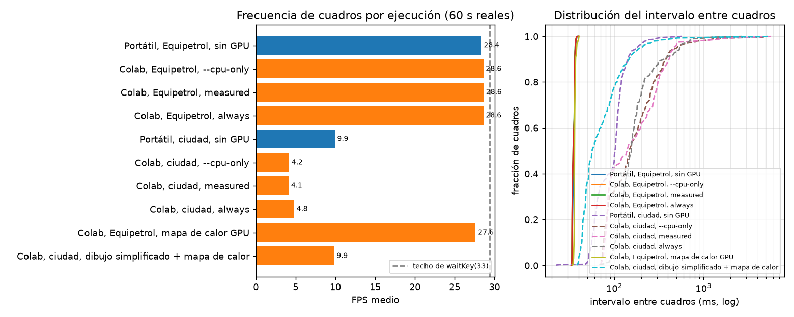

*Izquierda: FPS medio de cada ejecución; la línea discontinua es el techo del bucle de la ventana. Derecha: distribución acumulada del intervalo entre cuadros (eje logarítmico). Las curvas de Equipetrol son verticales en ~35 ms: todos los cuadros tardan lo mismo. Las de la ciudad se extienden hasta varios segundos.*

**Lectura:**
- **La GPU no afecta a la ventana.** En Equipetrol los tres modos dan **28,6 FPS**, con intervalos idénticos a la décima de milisegundo, incluso con la GPU trabajando en cada pedido. Es lo esperado por el diseño: la ventana corre en su propio hilo y nunca espera a la GPU; quien espera el `future` del `GpuWorker` es el despachador.
- **A escala de ciudad la ventana no mantiene la frecuencia en ningún modo, tampoco sin GPU.** El límite es **el propio dibujo**: 68 ms por cuadro en el portátil y 105–120 ms en Colab para pintar 3.000 repartidores y sus pedidos, mientras 3.000 hilos de repartidores compiten por 8 (portátil) o 2 (Colab) hilos de CPU. Los congelones de varios segundos (máximos de 2,8 a 6 s) aparecen en los tres modos de Colab: son planificación de la CPU, no la GPU.
- Las diferencias entre modos en la ciudad (4,1 a 4,8 FPS) están dentro de la variabilidad. El modo `always` dibuja algo más rápido probablemente porque asigna menos pedidos y hay menos marcas de entrega que pintar.
- **Veredicto:** la GPU no degrada la frecuencia de cuadros. Lo que limita la ventana a escala de ciudad es el dibujo, así que la solución es abaratar el dibujo, no cambiar el reparto CPU/GPU.

**Optimización aplicada al dibujo** (commit `5bced90`): con más de 200 repartidores, cada uno se dibuja como un punto de 2 px sin *antialiasing* (`LINE_8`) ni contorno, y las marcas de entrega se reducen. Con flotas pequeñas (Equipetrol) el dibujo no cambia.

| Portátil, ciudad, sin GPU | FPS | Intervalo p50 / p95 / máx (ms) | Dibujo p50 / p95 (ms) |
|---|---|---|---|
| Dibujo original | 9,9 | 102 / 178 / 572 | 67,7 / 142 |
| Dibujo simplificado (ejecución 1) | **18,6** | 51 / 80 / 279 | **16,0** / 41 |
| Dibujo simplificado (ejecución 2) | **19,0** | 48 / 81 / 359 | **14,4** / 43 |
| Equipetrol tras el cambio (control) | 28,2 | 35,6 / 37,2 / 38,6 | 1,1 / 1,8 |

- El dibujo por cuadro baja **de 68 a 15 ms (4,5 veces menos)** y la frecuencia **se duplica**. El suavizado de bordes de 3.000 círculos con contorno era la mayor parte del coste.
- La ventana sigue por debajo del techo (~29 FPS) porque los 3.000 hilos de repartidores compiten por 8 hilos de CPU: el p95 del intervalo (80 ms) dobla al del dibujo (41 ms).
- Las mediciones de Colab de la tabla anterior se hicieron con el dibujo original; la comparación entre modos de despacho sigue siendo válida, porque los tres modos usaban el mismo dibujo.

**Confirmación en la T4** (notebook `19-validar-ventana`, compilación con CUDA, Xvfb, modo `measured`, `--heatmap`): la compilación con la ventana pasa los **140 tests** y `compute-sanitizer --tool memcheck` informa **0 errores**.

| Colab, T4 | FPS | Intervalo p50 / p95 / máx (ms) | Dibujo p50 / p95 (ms) |
|---|---|---|---|
| Equipetrol, mapa de calor en la GPU | 27,6 | 36,0 / 38,0 / 40,9 | 1,9 / 3,4 |
| Ciudad, dibujo original, sin mapa de calor (tabla anterior) | 4,1 | 140 / 464 / 6.016 | 106 / 422 |
| Ciudad, dibujo simplificado **y** mapa de calor | **9,9** | 56,7 / 204 / 5.307 | **22,9** / 157 |

- En la T4 el dibujo típico de la ciudad baja **de 106 a 23 ms (4,6 veces menos)** y la frecuencia sube **de 4,1 a 9,9 FPS (2,4 veces)**, aunque ahora además se dibuja el mapa de calor. Es el mismo efecto medido en el portátil.
- En Equipetrol el mapa de calor cuesta 1 FPS (de 28,6 a 27,6), igual que en el portátil: suavizar en la GPU no frena la ventana.
- **Los congelones siguen.** Dividiendo la ejecución de la ciudad en tramos de 100 cuadros (`datos/fps/frames_colab_city_dense_heatmap.csv`):

| Cuadros | Dibujo p50 (ms) | Dibujo máx (ms) | Intervalo medio (ms) |
|---|---|---|---|
| 0–99 | 11,8 | 62 | 49 |
| 100–199 | 10,9 | 36 | 48 |
| 200–299 | 14,7 | 58 | 51 |
| 300–399 | 55,2 | 409 | 112 |
| 400–499 | 63,0 | 4.472 | 173 |
| 500–578 | 69,8 | 4.137 | 197 |

  El dibujo empeora a medida que crece la carga de la simulación: hay 29 cuadros de más de 200 ms y dos de más de 4 s. No viene de la GPU, que trabaja en otro hilo al que la ventana nunca espera.

**¿De dónde vienen los congelones?** Para averiguarlo, el registro de cuadros guarda dos tiempos más por cuadro: `lock_ms`, la espera del *lock* compartido de la flota (`transferMutex`), y `couriers_ms`, el dibujo completo de los repartidores con esa espera incluida. Ejecución de la ciudad en el portátil con `--heatmap`, 790 cuadros (`datos/fps/frames_laptop_city_lock.csv`):

| Cuadros | Dibujo p50 / máx (ms) | Espera del *lock* p50 / máx (ms) | Repartidores p50 / máx (ms) |
|---|---|---|---|
| 0–99 | 10,0 / 73 | 0,00 / 0,0 | 4,0 / 58 |
| 300–399 | 23,0 / 125 | 0,00 / 0,1 | 14,8 / 110 |
| 500–599 | 32,5 / 811 | 0,00 / 0,0 | 21,9 / 808 |
| 700–789 | 33,5 / 195 | 0,00 / 0,0 | 23,1 / 192 |

- **El *lock* de la flota no es la causa:** la espera nunca pasa de 0,1 ms. La hipótesis inicial queda descartada.
- **La causa está en el bucle que dibuja a los repartidores:** se lleva el **75 %** del tiempo de los 38 cuadros de más de 100 ms. En el peor cuadro, 808 de 811 ms. En ese bucle, la ventana pide tres veces por cuadro el *mutex* propio de cada uno de los 3.000 repartidores (bolsa de pedidos, posición y estado). Si el hilo del repartidor lo tiene tomado, o si el sistema operativo saca a la ventana de la CPU a mitad del bucle, el cuadro se alarga. Con esta medición no se puede separar una causa de la otra.
- La mejora posible sería que cada repartidor publique su posición en una copia que la ventana lea sin pedir 3.000 *mutex*. Es un cambio de diseño de la parte concurrente y queda fuera del alcance de las aplicaciones GPU.
- La captura de la ciudad muestra 2.512 pedidos rechazados por `queueFull`. Es el mismo efecto de la CPU de Colab descrito en el apartado 5 (2 vCPU frente a 3.000 hilos) y no depende de la ventana.

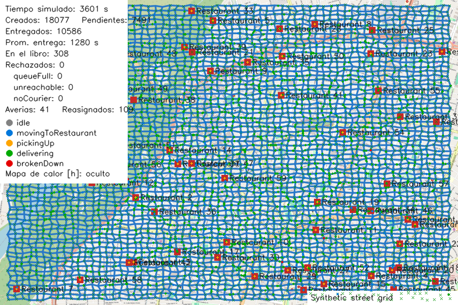

*La ventana de la ciudad (4.096 nodos, 3.000 repartidores) al final de 1 hora simulada, con el dibujo simplificado: cada punto es un repartidor y los cuadrados rojos son los 60 restaurantes.*

---

## 6. Conclusiones y amenazas a la validez

### Conclusiones
- **La GPU compensa cuando hay mucho trabajo por byte copiado o los datos se quedan en la GPU:**
  - stencil (100 barridos sobre los mismos datos): 5,4×;
  - ETA + argmin encadenados: 15×;
  - mezcla (12 rondas): 3,8×;
  - radix sort (22 pasadas): 2,4×;
  - convolución con rejillas finas: 1,9×.
- **No compensa cuando el trabajo es de una pasada y los datos viven en la CPU** (filtro, histograma, agrupación y argmin por separado): el kernel es entre 10 y 30 veces más rápido, pero **las copias por PCIe suponen entre el 90 y el 98 % del tiempo**.
- **No compensa cuando la GPU ejecuta un algoritmo peor:** Floyd–Warshall `O(n³)` frente a Dijkstra en un grafo con pocas aristas.
- **A la escala del enunciado** (Equipetrol) ninguna tarea supera su cruce: **la respuesta es mantener la CPU**.
- **A escala de ciudad**, la respuesta correcta es **usar la GPU solo por encima de un umbral**, y el despachador ya está implementado así. Forzar la GPU en cada pedido (`--gpu-dispatch always`) reduce las asignaciones un 29 % y multiplica por 10 la latencia de despacho.
- **¿Y con un mapa más grande?** No cambia el marcador. Los barridos de tamaño ya llegan bastante más allá de la ciudad, y muestran tres tendencias:
  - Donde la GPU gana, gana algo más al crecer (convolución de 1,43× a 1,89×; mezcla de 2,99× a 3,82×).
  - En las tareas de una pasada, la GPU **no** se recupera, porque la copia por PCIe crece al mismo ritmo que el trabajo de la CPU. El histograma incluso empeora: de 0,59× con 1 millón a 0,27× con 16 millones.
  - En Floyd–Warshall la CPU gana **más** cuanto mayor es el grafo (de 1,06× con 576 nodos a 0,63× con 4.096): la GPU hace `n³` operaciones y Dijkstra crece aproximadamente como `n² log n` en un mapa de calles.
- **Mejora posible: despacho por lotes.** El despacho usa la CPU porque atiende un pedido cada vez (~300 candidatos), muy por debajo del cruce de la ETA (~50.000 pares). Acumular los pedidos de una ventana corta (por ejemplo, 200 pedidos × 3.000 repartidores = 600.000 pares) y asignarlos juntos con ETA + argmin en la GPU llevaría la simulación a la zona en la que la GPU gana entre 4× y 15× en el bench. Lo que decide si gana la GPU es la cantidad de trabajo por cada viaje, no el tamaño del mapa.
- **La GPU no degrada la ventana:** 28,6 FPS en los tres modos en Equipetrol. A escala de ciudad la ventana baja a 4–10 FPS incluso sin GPU, porque el límite es dibujar 3.000 repartidores.

### Amenazas a la validez
- **Dos máquinas distintas:** la CPU del portátil (i5-1135G7, 8 hilos) se compara con la GPU de Colab. Para cubrirlo se incluye la comparación en la misma máquina (Colab: CPU de 2 vCPU frente a la T4), en la que la GPU gana en más casos porque la CPU es más débil.
- **Colab es compartido:** no se controla la carga de otros usuarios ni el reloj de la T4. La dispersión se mantuvo baja en la GPU (mín.–máx. dentro de ±5 % en casi todos los tamaños). En la CPU de Colab hubo valores atípicos de hasta 2× (por ejemplo, el máximo de `demand_heatmap` 2.048² con 1 hilo): por eso se informa de la mediana.
- **WSL2:** las barreras y los cambios de contexto de hilos son más caros que en Linux nativo, y eso penaliza las versiones multihilo con mucha sincronización (el stencil).
- **Calor del portátil:** se mitigó intercalando versiones y con el plan "Máximo rendimiento", pero no se controló la temperatura.
- **Modelos de *roofline* derivados del código:** cuentan operaciones enteras y bytes de forma aproximada (por ejemplo, 32 B por cada lectura dispersa de la tabla). Las conclusiones (qué kernels están limitados por la memoria) coinciden con los porcentajes de DRAM, L1 y SM que mide `ncu`.
- **Frecuencia de cuadros con pantalla virtual:** la combinación "ventana + GPU" se midió en Colab con Xvfb, porque ninguna máquina disponible tiene a la vez pantalla y GPU NVIDIA. Xvfb dibuja por software igual que con una pantalla real, pero no mide el coste de presentar la imagen en un monitor. Los FPS de Colab y del portátil no son comparables entre sí (2 frente a 8 hilos de CPU); la comparación entre modos se hace siempre en la misma máquina.
- **Tamaños no alcanzados:** la tabla de viajes no se midió por encima de 4.096 nodos, porque su matriz `n²` ocupa 64 MB y el tiempo de la CPU de 1 hilo ya era de casi 1 s. Por la tendencia medida (la GPU pierde cada vez más) no se espera que un grafo mayor cambie el veredicto. El resto de aplicaciones llega a 1–16 millones de elementos.
- **Emulación:** los tiempos de `cuda_compat.h` no se usaron para ninguna conclusión. Solo validan resultados en los tests.

### Evidencia de correctitud (resumen)
- **140 tests** pasan en el portátil (emulación); 133 pasaron en la T4 en la medición del paso 17. Los 7 nuevos (estadísticas de cuadros, despacho forzado y reparto en celdas) no tocan código de GPU.
- `compute-sanitizer --tool memcheck`: **0 errores**, también repetido con la versión que incluye la ventana y `--gpu-dispatch`. `--tool racecheck`: **0 riesgos de carrera**, en la suite completa.
- **ThreadSanitizer** (portátil): 0 avisos en los tests del `GpuWorker`, ETA, argmin y cobertura, y en la simulación `--headless`.
- `tools/check_event_log.py` valida el registro de eventos de cada simulación: ningún pedido perdido, duplicado ni asignado a dos repartidores.
